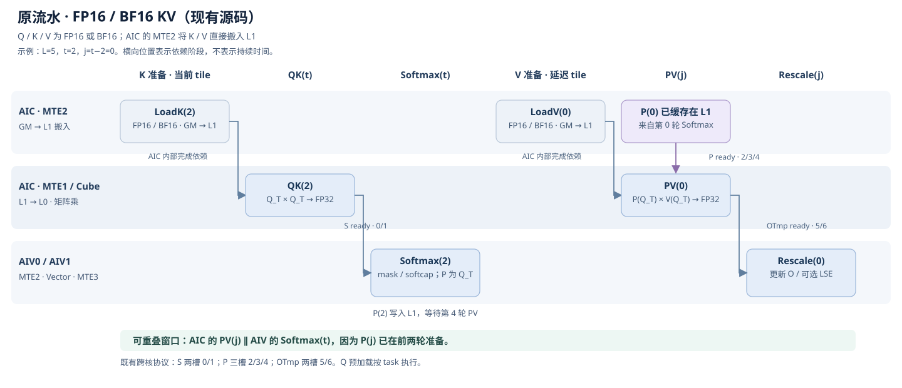
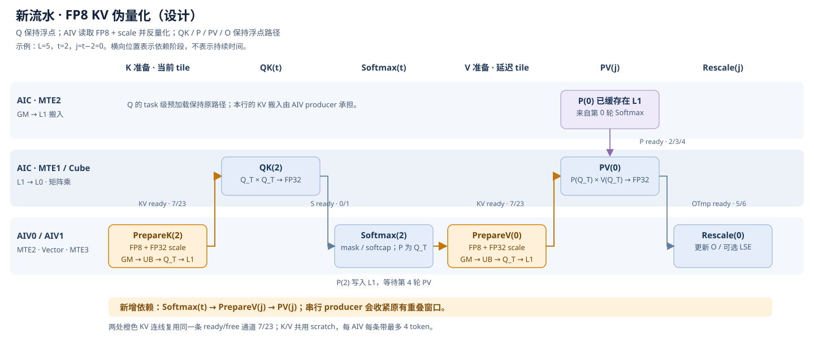
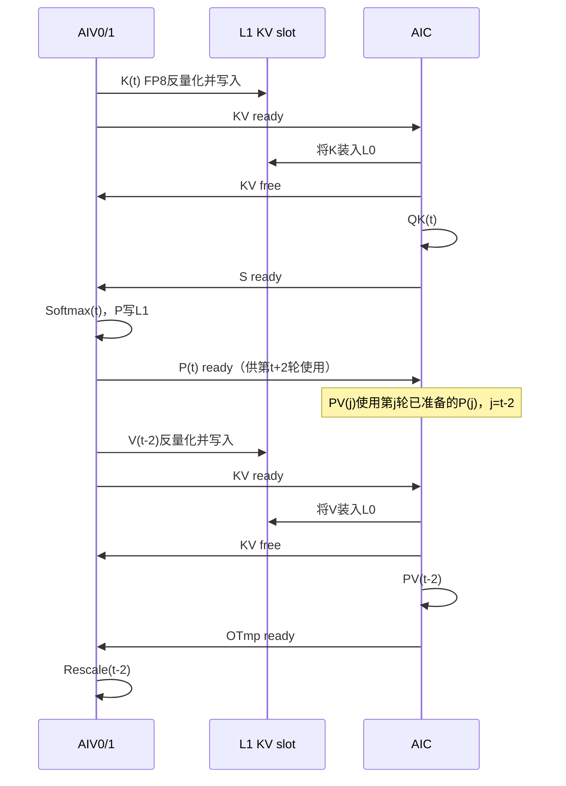

# Ascend 950 FA3：FP8 KV 伪量化与 per-token / per-head 
[测试用例设计](../tests/st/FP8_ANTIQUANT_TEST_DESIGN.md) 

## 1. 决策与范围

主方案是在现有浮点 FA 的 **KV 搬入位置增加 AIV 分块反量化**：`FP8 GM → UB → FP32 乘 scale → Q dtype → L1 → 浮点 Cube`。复用现有 QK、online softmax、PV、rescale、输出和 FlashDecode combine 的数学实现。新增存储类型与计算类型的边界，不把现有全 FP8 分支改成混合输入。

为控制修改范围，新增分支固定使用普通 `FAInfer` 方向，`enable_dn=false`；保留原生浮点和全 FP8 的 dispatch。新增 K/V 反量化共享一个小 UB scratch 和一个核间握手通道，先交付正确的融合流水，再考虑独立的预取优化。

### 1.1 本次完整交付规格

| 维度 | 拟支持 |
|---|---|
| Q / O | FP16 或 BF16；O 与 Q 同 dtype |
| K / V | 二者均为 `torch.float8_e4m3fn`，Dk、Dv 可不同 |
| scale | K/V 各自提供 FP32 scale；per-head、per-token、per-token × per-head；允许 K/V 使用不同粒度 |
| 注意力 | MHA、GQA、MQA；沿用现有 right-bottom causal、SWA、softcap 和可选 FP32 LSE |
| 布局 | dense BSND / BNSD；packed TND；现有 ND paged KV `[numBlocks, blockSize, Hkv, D]` |
| 长度 | 正长度；保留 `cu_seqlens` 存储区域与 `seqused` 有效长度的区别 |
| head dimension | 与现有浮点入口一致，`1 ≤ Dk,Dv ≤ 256`；内部补齐到 16 |
| 页大小 | 沿用 128 / 256 / 512 / 1024 |
| 调度 | 普通 Host Tiling、AICPU scheduler metadata；现有合法 FlashDecode 场景及 combine |
| 执行 | eager；同一 stream；metadata 路径的 NPUGraph / torch.compile fake 推导 |

这是推理能力。新增路径在 forward 就拒绝 Q/K/V/scale 的 `requires_grad=True`。不新增 FP8 KV 量化器、backward、offset、FP8 E5M2、MXFP8、FP4、KV append、RoPE、leftpad、`cache_batch_idx`、NZ cache 等功能。原入口本来不支持的组合继续按原规则拒绝；不因新增伪量化自动放开。

## 2. 当前代码事实与参考设计

### 2.1 当前调用链

| 层 | 当前入口 / 事实 | 新增职责 |
|---|---|---|
| 包导出 | [__init__.py](../../../../flash_attn_npu_3/__init__.py)，按芯片导出 950 接口 | 无新公开函数，沿用三个 forward 入口 |
| Python | [flash_attn_npu_interface_950.py](../../../../flash_attn_npu_3/flash_attn_npu_interface_950.py#L881)：`flash_attn_func` / `flash_attn_varlen_func` / `flash_attn_with_kvcache` | 混合 dtype 分类、模式参数、推理分支和 fake 推导 |
| custom op → 扩展 | [同文件 `_flash_attn_forward`](../../../../flash_attn_npu_3/flash_attn_npu_interface_950.py#L94)；[pybind](../flash_api.cpp#L323) | 新增混合输入 binding，复用 Host 实现 |
| Host | [mha_fwd.cpp](../mha_fwd.cpp#L68)：目前要求 Q/K/V 同 dtype；FP8 模式由 Q dtype 推断 | 分类 0/1/2；scale 校验和 descriptor；推理约束 |
| Tiling | [tiling_from_tensors.hpp](../tiling_from_tensors.hpp#L197) → [tiling.cpp](../tiling.cpp#L184) | 分离 Q 计算类型和 KV 量化类别 |
| AICPU | [fa_metadata_args.h](../fa_metadata_args.h#L106) → [fa_metadata.aicpu](../fa_metadata.aicpu#L80) | 与 Host 使用同一新分支 TilePlan |
| dispatch | [fwd_dispatch.hpp](../fwd_dispatch.hpp#L58) → [fwd_dispatch_impl.hpp](../fwd_dispatch_impl.hpp#L65) | mode 2 仍选择 FP16/BF16 TU，进入反量化 producer |
| kernel | [fwd_kernel.cpp](../fwd_kernel.cpp#L599)、[QK](../qk_matmul.hpp#L271)、[PV](../pv_matmul.hpp#L231) | AIV 生产浮点 KV，Cube 直接消费已准备的 L1 tile |

当前 `quant_mode=1` 是 Q/K/V 全 FP8，限制 Dk=Dv=128，descale 为 `[B,Hkv]`，O 为 BF16。新增能力不得改变这条路径的含义、默认 scale=1 或其测试标准。[当前校验](../mha_fwd.cpp#L239)

### 2.2 从 FIA 借鉴什么

| FIA 依据 | 借鉴点 | 本方案的取舍 |
|---|---|---|
| [Host antiquant 分派](../../../../../ops-transformer/attention/fused_infer_attention_score/op_host/arch35/fused_infer_attention_score_tiling_impl.cpp#L1427) | 将 antiquant 与 fullquant 分开 | 内部 mode 2 独立表示 FP8 KV antiquant |
| [per-token / head 参数](../../../../../ops-transformer/attention/fused_infer_attention_score/docs/aclnnFusedInferAttentionScoreV5.md#L1654) | token scale 与 token-head scale 是两种模式 | 保留编号 1/2/3；scale 统一 FP32；不搬入 FIA 的所有 mode 和限制 |
| [scale 地址计算](../../../../../ops-transformer/attention/fused_infer_attention_score/op_kernel/arch35/flash_attention_score_antiquant_processor.h#L346) | batch/head/token 分开索引 | 用项目自己的 ScaleDesc，适配 packed TND 和现有 paged 排布 |
| [反量化后写 L1](../../../../../ops-transformer/attention/fused_infer_attention_score/op_kernel/arch35/flash_attention_score_antiquant_processor.h#L517) | AIV 反量化，结果类型为 Q_T | K/V 不经整块浮点 GM 中转 |
| [Cube 使用 Q_T × Q_T](../../../../../ops-transformer/attention/fused_infer_attention_score/op_kernel/arch35/flash_attention_score_antiquant_block_cube.h#L216) | 两次矩阵乘保持浮点 | 复用本项目的 QK/PV，不复制整个 FIA kernel |

FIA 的 INT8 `Sq≤16`、特定 mode 的 dtype/分页限制不直接成为本项目 FP8 新路径的限制。新增路径的能力以本文及对应测试为准。

### 2.3 CATLASS 组件选择与本地依赖缺口

已参考本地 [CATLASS README](../../../catlass/README.md)、[GEMM 分层](../../../catlass/docs/contents/advanced/api.md)、[dispatch 说明](../../../catlass/docs/contents/advanced/dispatch_policies.md)、[Attention example](../../../catlass/examples/23_flash_attention_infer/README.md) 及其 kernel。example 用于理解组装，不作为 950 API 可用性证明。

当前本地 CATLASS 提交为 `c8948c340c4f30fb5964ccdd6e3a0bc7615fe202`，其 [arch.hpp](../../../catlass/include/catlass/arch/arch.hpp) 只定义 AtlasA2，而目标源码使用 `Arch::Ascend950`。因此，本地源码不能据此证明 950 编译可用。实施前必须使用项目已验证、包含 950 arch/dispatch/copy 特化的匹配依赖；不在本设计任务中更改 submodule。以下内存数字是设计预算，最终必须对实际 `ArchTag` 做编译检查。

| 组件 | 选择 |
|---|---|
| ArchTag | 现有 `Arch::Ascend950` |
| QK / PV DispatchPolicy | 保留项目 `MmadFlashAttentionQK/PV` 的非 DN 配置 |
| L0 TileShape | 保持当前 128×128×128 |
| BlockMmad | 抽出当前 L1→L0→Mmad→Fixpipe 的共享计算段，新增 `ComputeFromL1` 调用边界 |
| OnlineSoftmax | 现有 `EpilogueFAOnlineSoftmaxT<HasSoftcap>` |
| RescaleO | 现有 `EpilogueFARescaleO`，输入 KV **计算类型**必须是 Q_T |
| 新 producer | 项目内 `Fp8KvAntiquantProducer<Q_T>`，处理两个 FP8 存储 tensor |
| Scheduler / Kernel | 保留当前 grouped-Q、mask、FD task 拆分；`FAIKernel950` 增加默认 native 的 KV 输入策略 |

Epilogue 槽位核对：当前 online-softmax 依次接收 PType、SType、MaskType、TileCopySoftmax；rescale 接收 O、OTmp、S、KV 类型、TileCopy、源位置。新增反量化不是额外 softmax 输入，不向这些槽位塞 scale。scale 由 producer 消费；P 保持 Q_T。尤其不能把 FP8 **存储类型**传给 rescale 的 ElementKV，否则其 `FULL_QUANT_FP8` 推导会误启用全量化缩放。

## 3. 数学语义与精度

对 X∈{K,V}，定义 `X_eff = cast_Qdtype(float32(X_fp8) * scale_X)`，随后计算现有的 `Attention(Q,K_eff,V_eff)`。scale 乘法发生在 FP32，最后只做一次到 Q dtype 的舍入；这也是测试 oracle 的强制顺序。

```text
score = Q @ K_eff.T * softmax_scale
score = softcap * tanh(score / softcap)  # softcap > 0 时
P = softmax(mask(score))
O = P @ V_eff
LSE = logsumexp(mask(score))             # 不包含 V scale
```

这里是注意力的逻辑公式；实际继续使用 online-softmax 的分块归约与当前 P 舍入。V per-token scale 已在 PV 之前乘到 V，不能在最终 O 上乘一个标量代替。K per-token scale 不可简单折叠进全局 `softmax_scale`；per-head 虽可能有代数优化，本次统一走同一 producer，避免数值和分派分叉。

scale 数值契约为有限、非负，允许 0；输入 FP8 及还原后的 K/V 应保持有限且可表示。hot path 只校验 shape/dtype/device/stride，不用 `.item()` 或 D2H 扫描设备数值。可选 debug 验证器在图捕获外检查 NaN/Inf/负 scale/还原溢出；不宣称生产入口会同步拒绝设备上的非法数值。

## 4. Python 与底层接口

### 4.1 新参数与 dtype 分类

三个公开 forward 入口在现有参数末尾追加 **keyword-only** 参数：

```python
..., *, k_antiquant_mode: int = 2, v_antiquant_mode: int = 2
```

沿用 `k_descale` / `v_descale` 承载 K/V 反量化 scale，不新增重复 tensor 参数。新参数不插入旧 positional 参数中。

| 内部 quant_mode | dtype 组合 | scale 规则 |
|---|---|---|
| 0 | Q/K/V 同为 FP16 或同为 BF16 | 原规则；不接受 descale |
| 1 | Q/K/V 全为 FP8 E4M3 | 原规则；`q/k/v_descale` 可选，shape `[B,Hkv]` |
| **2** | Q 为 FP16/BF16，K/V 全为 FP8 E4M3 | K/V scale 必传；`q_descale=None`；两个 mode 各自为 1/2/3 |

其他混合类型、E5M2、K/V 类型不一致直接拒绝。新参数默认值 2 在旧路径无行为影响；旧路径显式使用非默认 antiquant mode 则报错，避免静默忽略。

Python 和 C++ 各有分类校验，C++ 不信任 Python 的检查。新增路径若任何 Q/K/V/scale 要求梯度，在 forward 立即报“FP8 KV antiquant is inference-only”。Python 新路径不经过 `FlashAttnFunc/FlashAttnVarlenFunc.apply`，而直接调用现有 custom-op forward 包装，从而不改旧 backward 返回参数元组。

### 4.2 scale 精确定义

`Hkv` 指 KV head 数，不能用 Hq；`Salloc` 是分配的 KV 序列长度；`Tkv` 是 packed 存储总 token 数。

| KV 存储 | mode 2：per-head | mode 1：per-token | mode 3：per-token-head |
|---|---|---|---|
| BSND / BNSD | `[B,Hkv]` | `[B,Salloc]` | `[B,Hkv,Salloc]` |
| packed TND | `[B,Hkv]` | `[Tkv]` | `[Tkv,Hkv]` |
| paged ND | `[B,Hkv]`，按逻辑请求 batch | `[numBlocks,blockSize]`，按物理页 | `[numBlocks,blockSize,Hkv]`，按物理页 |

全部为同设备、contiguous FP32。首版不自动广播 `[Hkv]`、不接受零 stride expand，不按 tensor rank 猜模式；默认 per-head 的精确 shape 保持 `[B,Hkv]`。dense mode 3 与 TND/paged 的轴序不同是显式接口契约，不允许将相同元素数的 tensor reshape 后当作等价语义。

GQA 中 `hkv = hq // (Hq/Hkv)`。同一 KV head 对应的 Q heads 使用同一份 K/V 数据和 scale；mode 1 还在 Hkv 之间共享 scale，mode 3 才在各 KV head 上独立。

```python
# 示例：BSND，Q BF16 / KV FP8；K per-token，V per-token-head
q = torch.randn(B, Sq, Hq, Dk, device="npu", dtype=torch.bfloat16)
k8 = k_quantized.to(torch.float8_e4m3fn)  # 调用者事先生成量化数据
v8 = v_quantized.to(torch.float8_e4m3fn)
out = flash_attn_func(
    q, k8, v8, causal=True,
    k_descale=k_scale_fp32,       # [B, Skv]
    v_descale=v_scale_fp32,       # [B, Hkv, Skv]
    k_antiquant_mode=1, v_antiquant_mode=3,
)
```

### 4.3 布局、stride 与 cache 契约

沿用当前布局检测与输出恢复，不假定 BNSD 的 O 物理排布和 BSND 相同。新 scale 不参与 Q/K/V 的布局检测，按上表单独校验。

最小实现只让 producer 直接读 canonical contiguous FP8 KV。dense/TND 非连续输入由 Python 在确定布局后显式 canonicalize；低层 binding 对未 canonicalize 的输入报错。paged cache 必须已经是 canonical ND contiguous，拒绝隐式复制整个 cache。Q 和 out 继续遵守现有入口的 stride 规则。测试分别验证“直接支持”“包装层 copy”“明确拒绝”，不把外层 stride 支持混为一谈。

cache 为只读；不更新数据或 scale。`k/v` append、cache 重排、RoPE/leftpad 等按当前 950 入口规则拒绝。外部修改 cache/scale 需要由调用者保证 stream 依赖；不额外同步全设备。

### 4.4 custom op / pybind / 异步生命周期

内部 `_flash_attn_forward` 和 fake 实现末尾追加两个带默认值的 mode 参数。真实实现根据 dtype 组合选择原 `.fwd` 或新增 `.fwd_antiquant`；fake 使用 Q dtype 推导 O，LSE shape 和原布局契约一致。

为了保留旧 `.fwd` 的调用参数数量：将 Host 主体抽成 `mha_fwd_impl(..., optional<AntiquantCallSpec>)`，原 `mha_fwd` 为原签名薄包装，新增 `mha_fwd_antiquant` 只添加两个 mode。两者共用主体；不复制一份几百行的 `mha_fwd.cpp`。

`FwdLaunchArgs` / kernel Params 附加两个 ScaleDesc 和 FP8 存储指针。`RunOpApiV2` 的 lambda 必须按值持有 K/V scale 以及 canonicalize 后的 FP8 tensor，覆盖异步 launch 和 allocator 生命周期。custom op 的 tensor 参数不能藏成 Python 全局缓存或裸整数地址，否则 graph/compiler 无法跟踪依赖。

### 4.5 不能遗漏的旧分支条件

不要全局替换 `quantMode==0/1`；应明确区分 `uses_fp8_mma = (mode==1)`、`uses_fp8_storage = (mode!=0)` 和 `needs_antiquant = (mode==2)`，逐处审查：

- 当前 `k.dtype()==q.dtype()` / `v.dtype()==q.dtype()` 只用于 mode 0/1；mode 2 使用混合类型校验。
- 当前 Dk=Dv=128 限制只属于 mode 1，mode 2 沿用浮点 D 范围。
- 当前 `[B,Hkv]` 的 `set_descale` 校验只用于 mode 1；mode 2 走 ScaleDesc 的对应 shape 校验。
- **两处** triu mask 创建条件（外部 metadata 路径和 Host Tiling 路径）当前是 `hasMask && quantMode==0`，必须改为 `hasMask && !uses_fp8_mma`，否则 mode 2 会缺少浮点 softmax 所需 mask。
- FD 的 LSE sub-stride、P 的 256 倍缩放补偿和 BF16 强制输出只属于 mode 1。mode 2 不重复乘 K/V scale。
- Python metadata 自动构建不能再只看 Q dtype；否则会为混合输入错误地产生 mode 0 metadata。
- graph capture 使用预先构建、与本次几何匹配的 metadata；不宣称 Host Tiling 的 D2H 长度读取可在 capture 中运行。

## 5. 地址模型

### 5.1 统一 descriptor

拟新增的 POD（项目内部类型，不是 CANN 官方 API）：

```cpp
struct KvScaleDesc {
    GM_ADDR ptr;             // FP32，只在本次调用中使用，不写入 scheduler metadata
    uint32_t mode;           // 1 / 2 / 3
    uint32_t storageKind;    // Dense / PackedTnd / PhysicalPage
    uint64_t batchStride;    // 以 float 元素为单位
    uint64_t headStride;
    uint64_t tokenStride;
    uint64_t pageStride;
};
```

shape/stride 只由 Host 根据已校验的 canonical tensor 推导。所有偏移用 64 位，不将 FP8 元素 stride 与 Q_T 字节数混用。

### 5.2 三种地址

```text
dense 数据：base + b*batchStride + hkv*headStride + t*tokenStride + d
TND 数据：base + (cu_k[b]+t)*tokenStride + hkv*headStride + d
paged 数据：p=page_table[b,t//blockSize], u=t%blockSize
            base + p*pageStride + u*tokenStride + hkv*headStride + d
```

scale 对应为：

| 模式 | Dense | TND | Paged |
|---|---|---|---|
| per-head | `S[b,hkv]` | `S[b,hkv]` | `S[b,hkv]` |
| per-token | `S[b,t]` | `S[cu_k[b]+t]` | `S[p,u]` |
| per-token-head | `S[b,hkv,t]` | `S[cu_k[b]+t,hkv]` | `S[p,u,hkv]` |

mask/SWA 跳过 tile 或 FD 从中段开始时，t 始终是**原始逻辑 KV token 索引**，不能用 `kvSTileRelIdx` / split 内序号代替。packed 地址跟随 cu 的物理 region，不跟随 `seqused` 的紧缩前缀和。分页 data/scale 使用同一个 page table lookup。

## 6. Tiling 设计

### 6.1 Host 与 AICPU 共用 TilePlan

`FAInferContext` 新增 `quantMode=0`；`dataType` 继续代表 Q 的计算类型。修复目前只由 `dataType==FP8` 重建 quantMode 的逻辑。内部模式值 0/1 不变，2 为新路径。

新增不依赖 torch 的 `BuildAntiquantTilePlan(Dk,Dv)` helper，供 `tiling.cpp` 与 `fa_metadata.aicpu` 共用，禁止各复制一套数值。mode 2 的初始配置：

| 字段 | 值 / 理由 |
|---|---|
| `qBaseTile` | Dv>128 时 64，否则 128；保持当前浮点策略 |
| `kvBaseTile` | **128**；与普通浮点相同，避免全 FP8 的 256 路径 |
| `qkL1TileM / KLeft` | 128 / align16(Dk)；保留 Q 最大合并行容量 |
| `qkL1TileN / KRight` | **128 / align16(Dk)**；完整容纳本 tile 反量化后的 K |
| `pvL1TileM / N / KLeft / KRight` | 128 / align16(Dv) / 128 / 128 |
| Q/K/V/P L1 buf 个数 | 1 / 2 / 2 / 3；不增加 buffer 数 |
| producer stripe | 每 AIV 每次最多 4 token，K/V 共用 scratch，单次 in-flight |
| `innerPrec` | 0，沿用浮点高精度 softmax |
| DN | 新路径固定关闭；不改 `qk_matmul_DN.hpp` |

### 6.2 调度与 grouped-Q

沿用当前 Host/Device 的 `GetQNBlockTile`、`qNBlockNumPerGroup * qSBlockNum * Hkv` 任务模型和 `[head][S]` 合并行顺序。producer 的 KV head 从同一个 task 的 `kvHeadIdx` 取得；一个 task 中 qN 合并不重复为每个 Q head 反量化同一个 KV tile。

所有模式使用相同内存预算，mode 1/2/3 只改变 scale 索引，不为 3×3 个模式组合展开额外 kernel 模板。K/V 模式混用也是同一个运行时 descriptor 分支。

masked 路径仍调用现有 S2 loop range、边界 mask 与 grouped-row 限制。不能照搬旧版本的 qN=1 假设，也不能在新路径擅自改变当前 mask 行映射。[当前任务解码](../fwd_kernel.cpp#L403)

### 6.3 内存预算

L1 保守按 M=128、N=128、DkA=DvA=256、Q_T=2 byte 计算：

| L1 region | 大小 |
|---|---:|
| Q：1×128×DkA×2 | 65,536 B |
| K：2×128×DkA×2 | 131,072 B |
| P：3×128×128×2 | 98,304 B |
| V：2×128×DvA×2 | 131,072 B |
| 合计 / 512 KiB 上限 | **425,984 / 524,288 B** |

K/V region 沿用当前地址顺序；producer 与消费者必须使用同一个 TilePlan / layout helper 获取偏移，不各自推算。L0 保留现有 pool 和 ping-pong 规则；新增 producer 不分配 L0。编译断言检查 `128×128×2` 与实际 L0A/B 单槽、`128×128×4` 与实际 L0C 单槽的容量关系；不能拿本地 AtlasA2 常量替代缺失的 Ascend950 定义。

UB 以当前 masked 浮点高精度路径的保守区间核算：[softmax offsets](../online_softmax.hpp#L87)、[rescale offsets](../rescale_o.hpp#L50)。

| UB region | 字节区间（左闭右开） |
|---|---|
| S 两槽 | `[0,65,536)` |
| P 两槽 | `[65,536,98,816)`；到 131,072 的间隙不默认当 scratch |
| OTmp 两槽 | `[131,072,196,608)` |
| running O | `[196,608,229,376)` |
| m/l/dm 状态，按 FP32 保守计 | `[229,376,231,168)` |
| 两份 mask 的上界 | `[231,168,247,552)` |
| 新 scratch 起点 | **247,552 B，256B 对齐** |

对 stripe R=4、Da=max(align16(Dk),align16(Dv))≤256：

```text
input_fp8  = R*align32(max(Dk,Dv)) ≤ 1,024 B
output_nd  = align32(R*Da*2)     ≤ 2,048 B
output_l1_packed = 同上          ≤ 2,048 B
scale_fp32 = align32(R*4)        =    32 B
scratch_total                  ≤ 5,152 B
UB_end                         ≤ 252,704 B
248 KiB                        = 253,952 B
预算余量                       =   1,248 B
```

FP32 中间值放 vector registers，不新增 FP32 整块 UB；K/V 串行共用 scratch。FP8 GM→UB 每行按32B补齐，即使 D≤16 也不能只留16B行距。packed UB 仅存实际 R 行 × Da 的 16-channel 片段；不能为了 ND2NZ 在 UB 内扩成 16×Da（会破坏预算）。L1 的 tail padding 由 producer 直接写零片段完成。

上述范围是当前源码的保守上界分析，不是 profiler 测量。实施必须加入布局静态/Host 断言与 `end <= ArchTag::UB_SIZE`；任何新临时数组或编译器要求的用户 scratch 均计入。容量不满足时应调整 stripe/方案并更新测试，不允许静默越界或复用仍存活的 S/P/mask 区。

### 6.4 Workspace 与 metadata ABI

不增加完整反量化 KV 的 GM workspace。普通/FD 原 workspace 分配策略继续沿用；不能因此宣称普通调用的总 workspace 为零，当前代码仍有既有分配公式/metadata workspace floor。[workspace](../tiling.cpp#L225)、[metadata floor](../fa_metadata_args.h#L20)

`FAInferTilingData` 已有 `quantMode` 字段，首版不新增字段、不改变 sizeof；stripe 与 UB plan 由分支固定，ScaleDesc 作为本次 launch 参数。现有 `[TilingData | kvCum]` metadata 字节布局保持。

`get_scheduler_metadata(..., *, kv_dtype=None)`：原 `qkv_dtype` 解释为 Q dtype；`kv_dtype=None` 表示与 Q 相同；传入 FP8 KV + 浮点 Q 得到内部 mode 2。`FAMetadataArgs.quantMode` 已存在，放开 2；Host 与 AICPU 都写完整 antiquant TilePlan。metadata 不包含 scale 指针、数值或 mode 1/2/3，因几何相同可跨这些 scale 模式和数值复用。

只允许几何、dtype 类别、layout、长度、mask/window 和调度配置匹配的 metadata。普通 mode 0 和 antiquant mode 2 不能交叉复用：kvBaseTile 相同也不意味着 K L1 几何相同。Host 自建路径可直接检查；外部 NPU opaque metadata 不允许为检查而 D2H。debug 构建在设备入口做均匀的 mode/几何一致性断言；生产调用者必须按 metadata 契约使用，不承诺对任意被篡改的 byte tensor 做同步诊断。保留现有 clone/copy_ 语义，不依赖 Python tensor 附属属性。

## 7. kernel 与流水设计

### 7.0 原流水与新流水对照

[打开交互式流水对比图](FP8_ANTIQUANT_PIPELINE.html)：可选择 KV tile 数和当前轮次，比较 `PRE_LAUNCH=2` 下的预热、稳态和排空，并单独强调新增阶段。以下 SVG 可直接在 Markdown 中查看，也可放大或编辑。

对照基线是**当前 FP16/BF16 KV 的普通非 DN 流水**；新增伪量化正是复用这条浮点计算路径。示例取 `L=5、t=2、j=t−2=0`，因此 `QK(2)/Softmax(2)` 和 `PV(0)/Rescale(0)` 处理的是不同 KV tile。图中的横向位置表示依赖阶段，**不是实测时间轴，也不按耗时比例绘制**。

**图 7-1：原流水。** AIC 的 MTE2 将浮点 K/V 直接搬入 L1；AIV 执行 softmax、P 写 L1 和 rescale。PV(j) 使用前两轮已准备的 P(j)，在依赖上可与本轮 Softmax(t) 重叠。



**图 7-2：新增伪量化流水（设计）。** 橙色为新增的 AIV `PrepareK/PrepareV`：读取 FP8 和 FP32 scale、反量化并写浮点 L1 tile。QK、softmax、PV、rescale 的数学类型保持原路径；两处 KV ready/free 复用同一条 7/23 通道。



| 对比点 | 原流水 | 新流水 |
|---|---|---|
| KV 存储与搬入 | FP16/BF16，由 AIC MTE2 直接 GM→L1 | FP8，由 AIV 完成 GM→UB→FP32乘scale→Q_T→L1 |
| AIV 工作 | Softmax(t)、Rescale(j) | PrepareK(t)、Softmax(t)、PrepareV(j)、Rescale(j) |
| Cube 数学 | Q_T×Q_T，FP32累加 | 同一浮点数学路径 |
| 新依赖 | 无 KV 反量化 producer | AIC 等待 KV ready，读完 L1 后归还 free |
| 重叠窗口 | PV(j) 可与 Softmax(t) 重叠 | 首版串行方案新增 `Softmax(t)→PrepareV(j)→PV(j)`，收紧此重叠窗口 |

图示只说明设计依赖。新增反量化与 softmax/rescale 共用 AIV，可能增加 AIC 等待；是否获益必须按第十章的端到端基线实测。预热 `t=0/1` 没有延迟 PV，排空 `t=L/L+1` 不再产生当前 K/QK/Softmax，完整轮次可在交互图中切换。图 7-1/7-2 保留为最小实现的对照，第八章另述优化后的任务组织与资源方案。

### 7.1 输入边界与计算复用

`FAIKernel950` 增加一个默认 native 的 KV 输入策略；新策略定义 `StorageK/V=float8_e4m3_t`、`ComputeK/V=Q_T`。Q、P、O 都是 Q_T，S/OTmp 为 FP32。普通路径的实例化默认参数不变。

将 QK/PV block 中“GM→L1”和“L1→L0→Mmad→Fixpipe”拆出共享内部边界：原 `operator()` 仍先完成 native load 再调用同一计算段；新增 `ComputeFromL1` 接收已准备好的 L1 view。它不接受一个伪装成 Q_T 的 FP8 GM tensor，也不再执行 GM→L1。

QK antiquant tile N=128，避免现有 nL0Loop 中重复等待同一 KV-ready。消费者仍按当前 `pipelineTileSeq`、L0 prefix 和 Fixpipe ownership 工作。**不修改原 split/no-split 的 copy 调用签名，不把所有 Fixpipe 改成 NO_SPLIT。**

抽取计算段时，native GM→L1 的 `MTE1_MTE2 / MTE2_MTE1` 等待和归还也属于 native loader 生命周期。新 `ComputeFromL1` 不能保留其最后的 native free set，却跳过前面的 native wait，否则会产生多余 credit。新增 KV 通道单独负责反量化 L1 的 ready/free；原有 Q、L0 和 S/P/OTmp 协议照旧。

### 7.2 producer 的工作

1. 从共享 task 取得 b、hkv、逻辑 KV tile 起点及有效行数。
2. 两个 AIV 按 token 行划分：令 `Nphys=align16(Nvalid)`，子核 a 拥有 `[a*Nphys/2,(a+1)*Nphys/2)`，其中 `t>=Nvalid` 的行只写零、不读GM。划分与 L1 实际存储行一致，和 Q 输出的 head/S 分工是两套职责。
3. 每次最多 4 行，按存储 layout 读取 FP8 和对应 FP32 scale。page 边界处分段，数据和 scale 共用 p/u；无效 page table entry 不得因预取而读取。
4. FP8 解码到 FP32、乘 scale、RNE cast 到 Q_T，并打包成消费者要求的 L1 16-channel 片段。
5. K 目标用 QK 的 `LayoutTagL1B`（逻辑 Dk×N），V 用 PV 的 `LayoutTagL1B`（逻辑 N×Dv）。统一 layout helper 计算 `layout(d,t)` / `layout(t,d)`；禁止把 K/V 当作同一种 ND→NZ 拷贝。
6. MTE3 完成所有本 AIV 片段后发 ready；尾部无数据的 AIV 也参与握手。

首版串行 producer 不使用额外双缓冲预取；KV 反量化和 softmax 竞争 AIV 时间是可测的成本，不能仅凭“单 kernel”宣称吞吐提升。

### 7.3 主循环与 PRE_LAUNCH=2

沿用当前 `for t in range(kvSLoopCount+2)`；两条执行轨道如下：

| 每轮 t | AIC | 两个 AIV |
|---|---|---|
| t<L | 等待 K(t) ready；QK(t)；保留 S ready/free 协议 | **PrepareK(t)**；随后原 Softmax(t) |
| t≥2 且 j=t−2<L | 等待 V(j) ready 和 P(j) ready；PV(j) | **PrepareV(j)**；随后原 Rescale(j) |
| 尾轮 | 仅处理 j=t−2 | 同步处理相同有效 j；不产生不存在的 K |



反量化放在对应消费者的前面，不能先等 QK(t) 完成再生产 K(t)，也不能在 AIV 等 PV(j) 结果之后才准备 V(j)。这是无循环等待的关键。

### 7.4 新增事件只使用一条串行通道

当前 cross-core base ID：QK/S 为 0、1；P 为 2、3、4；PV/OTmp 为 5、6。[初始化](../fwd_kernel.cpp#L780)

| 通道 | 协议 |
|---|---|
| 新 KV 通道 base 7 | K/V 共用，按主循环实际发生的 K(t)、V(t−2) 阶段顺序复用；预热只有 K，排空只有 V；同一时刻最多一个阶段未完成 |
| 两个 AIV | 沿用现有 mode-4 的 base / base+16 对应方式，即 7 / 23；helper 必须明确双方发送/等待语义 |
| 初始化 | AIC 发布一个初始 free credit 给每个 AIV；AIV 在写入前消费 |
| ready | AIV 在 MTE3→L1 完成后发布；AIC 必须等待两个子核的完成条件 |
| free | AIC 的最后一次 L1→L0 MTE1 完成后发布，不能在刚发出 LoadData 时提前释放 |
| 排空 | 所有实际 KV 阶段消费完成后，按初始 credit 数排空；空任务不额外 set/wait |

ready/free 使用与现有双向 cross-core 通道一致的方向性语义；不要把两个方向当作同一个无方向 software counter。每次 ready 都有反向 credit，避免累计连续 set 超过 flag 深度。7/23 必须在实际 950 matching headers 上做最小握手 probe；本地旧 CATLASS 的 FFTS 声明不是 950 硬件已验证结论。

拟分配 vector 局部事件：输入复用 `V_MTE2/MTE2_V` 的 ID 2；输出复用 `V_MTE3/MTE3_V` 的 ID 5。现有 softmax 用 0/1、mask 用 4/5 的 V_MTE2，rescale/init 的 MTE3_V 用 4/6/7；**按 HardEvent 类型计数**，不能只比较数值 ID。对全部编译包含路径（含 FD combine）做事件账本；如实际 matching dependency 另占这些 ID，必须重新分配并更新本文，禁止依赖“看起来空闲”。单 scratch 不增加第二组事件。

producer 的局部初始化分别给 `V_MTE2(2)` 和 `MTE3_V(5)` 一个初始 free credit；每条带消费 input-free，完成 MTE2→V 后计算，消费 output-free，完成 V→MTE3 后写 L1，再归还相应 credit。结束时由 producer 自己排空新增 credit，不依赖原 `ReleaseSyncFlags()` 偶然处理新 ID。发布 tile-ready 的 MTE3 事件必须排在本 tile 所有 L1 copy 之后。

### 7.5 L1、UB 生命周期与 FD

K/V L1 槽仍为两个，但首次交付不跨阶段 lookahead；通道 free 决定可写，`pipelineTileSeq % 2` 决定实际槽。K/V 有各自 L1 region，不会因为共用通道而覆盖彼此。L1 consumer release 要覆盖该 tile 所有 L0 K/M/N 子循环。

UB input 在 MTE2→V 就绪后才能读；output 在 V→MTE3 就绪后才能搬；scratch 在 MTE3 完成后才允许下一条带复用。已有 softmax/P 与 rescale 的异步 buffer 仍按原协议保护，新增 scratch 不 alias 它们。

FD 保留当前 `pipelineTileBase` / L0 stage prefix 跨任务延续，不用 split 内局部序号重置已有缓冲。scale 用原 KV token 坐标，不能附带 split 偏移两次。FD 输出 partial O/LSE 与浮点路径同型，`fdLseSubStride` 走非全 FP8 规则；combine 不接收也不再乘 descale。进入 combine 前先完整排空新增通道和 scratch。

所有 token 被 mask 掉的行、tile 被整体跳过、尾 stripe 只有 1 行、AIV1 无有效行，都需要与现有输出初始化契约一致，并保持两个 AIV 的握手次数相同。

## 8. 优化方案

本章面向 **GQA + SWA / right-bottom causal + FP8 KV 伪量化**。在第六、七章的基础流水上，优化任务划分、mask、缓冲和跨任务调度；反量化精度及 scale 地址契约保持不变。以下为待实施方案，资源预算需结合实际编译结果验证。

### 8.1 fusedTask：融合 GQA 尾块和短 Q

Host、AICPU、kernel 共用 `Task{qStart,qRows,headStart,heads}` 和 `MakeShape/Decode`，分别计算完整 Q tile 与尾块的任务数：

| 场景 | 任务组织 | 作用 |
|---|---|---|
| 完整 Q tile | 保持独立 head/task | 保留任务并行度 |
| Q 尾块 | 按实际 `qRows` 合并同一 KV group 内的 Q heads | 减少尾 task，同组共享一次 K/V 反量化 |
| 短 Q | 并行度与容量允许时，将多个 KV group 组织为多个 segment | 合并调度及向量处理；各 segment 独立执行 QK/PV 和反量化 |

例如 `Sq=129、Hq=32、Hkv=8、qTile=128`：完整部分 32 个 task，尾部按每组 4 个 Q heads 融合为 8 个 task，总数由 64 减为 40。

实现约束：

- mode 2 使用浮点计算几何；`quantized=uses_fp8_mma=false`，不因 KV 存储为 FP8 而选择全量化几何。
- 同组 producer 只准备一次 K/V；跨组按 `hkv=headStart/G+segmentId` 选择数据和 scale，`G=Hq/Hkv`。只有 per-token scale 可以跨 KV head 共享。
- L1 Q/P 按 segment 的 `align16(segmentRows)` 存储；UB S/OTmp 按有效行紧凑排列。有效行总数及 L1 对齐行总数均不超过 128，每 AIV 的状态行不超过 64。
- Fixpipe 按 segment 与 AIV 行区间的交集发布有效行；O/LSE 按原 head/token 地址写回。所有地址与任务计数使用真实 used lengths 和同一份几何。
- 首先支持组内融合。短 Q 跨组可从 `q<qTile、batch>=cores` 起步评估；跨组先使用任务内流水，FD 保持不跨组融合，SWA 不新增 FD 路径。

### 8.2 位置式 mask、UB 重排与 Q/K 供给

**移除 mask 矩阵。** Host 不再生成、分配或上传三角 mask；softmax 在寄存器中由 Q/K 位置生成谓词：

```text
q = task.qStart + logicalRow % qRows
c = q + Sk_used - Sq_used                 # right-bottom 对齐
k = 原始逻辑 KV token 位置
valid = (0 <= k < Sk_used)
causal: valid &= (k <= c)
SWA:    valid &= (left  < 0 or k >= c-left)
        valid &= (right < 0 or k <= c+right)
```

`logicalRow` 包含 AIV 的有效行起点，按每个 head 的 qRows 循环；L1 padding 不参与位置计算。causal+SWA 归一化窗口时仍保留 `k<=c`；使用当前 batch 的有效长度，有符号计算边界后再裁剪。先做 softcap，再屏蔽；全屏蔽行输出 O=0、LSE=-inf。

先裁剪 KV tile 范围，内部合法 tile 直接走无边界判断的 softmax，仅边界 tile 生成谓词。裁剪同时约束 K/V 反量化和 scale/page 读取；跳过 tile 不产生握手。优化路径删除 mask UB 区、DMA 及对应事件，第 4.5 节的 mask 创建条件仅适用于基础版本。

**UB 重排与双 PV buffer。** S、P、OTmp、running O、softmax 状态和最终统计快照共用一个资源计划。双 PV buffer 指 UB 中的两个 FP32 OTmp 槽，与 L1 双 V buffer 分开计算。

Dv192/Q128 的 OTmp 单槽为 `64*192*4=49,152 B`，双槽布局总计 249,856 B，已含最终 max/sum 快照 1,536 B 和 LSE scratch 256 B。直接追加 5,152 B 反量化 scratch 将超出 248 KiB 上限 1,056 B，因此该配置改用两行 stripe：

| Q128 配置，按 DkA≤256 保守计 | 原资源计划 | 反量化 scratch | UB 合计 | 余量 |
|---|---:|---:|---:|---:|
| Dv160 / OTmp×2 / R=4 | 225,280 B | 5,152 B | 230,432 B | 23,520 B |
| **Dv192 / OTmp×2 / R=2** | **249,856 B** | **2,592 B** | **252,448 B** | **1,504 B** |
| Dv256 / OTmp×1 / R=4 | 233,472 B | 5,152 B | 238,624 B | 15,328 B |

预算按单个 AIV 计算。`R=2` scratch 包含 FP8 输入 512 B、ND 输出 1,024 B、packed 输出 1,024 B、scale 32 B；K/V 串行共享。按 `align16(Dv)` 选择布局，Dv=177…192 均需覆盖。候选顺序为“双 OTmp+R4 → 双 OTmp+R2 → 单 OTmp/Q64”，每项均检查完整容量和对齐，不复用仍存活的区域。

**Q 双缓冲与紧凑 K。** Q 使用两个 L1 槽；K 保持 `128*align16(Dk)` 的紧凑布局。Dk=Dv=256 时，Q/K/P/V 合计 491,520 B；Dk256/Dv192 时为 458,752 B，均低于 512 KiB。第六章已经采用紧凑 K，此处只计新增 Q 槽，并统一重算各区域偏移。

Q 在任务间轮转，覆盖前等待旧 Q 的最后一次 MTE1 读取完成。同一任务各 KV tile 复用该 Q 槽；将 Q-ready 等待下移到第一次 L1 Q→L0A 之前，使 K 供给可以先启动。FP8 K 仍通过 KV ready/free 保护，`ComputeFromL1` 不保留原生 K DMA 的握手。Q 局部事件 0/5 与 producer 事件按侧别、HardEvent 类型及方向分别核算。

Q128 同时受任务波次和 SWA 窗口约束：Dv>128 时，可从完整 Q128 task 少于 `4*cores` 回退 Q64；窄窗口结合 OTmp 槽数选择。阈值需测量，不能仅凭 UB 可容纳就强制启用 Q128。

### 8.3 环形 PvTask：交错执行后续 QK 与前序 PV、输出

以三个 P 槽对应的环形 `PvTask` 保存待消费状态，跨 Q task 延续 `pipelineTileSeq` 和 L0 stage prefix，减少逐任务预热和排空。描述符保存 V/O/LSE 地址、batch/KV head、逻辑 KV 起点、页表/segment、有效行数、mask 边界、first/last/partial 和目标 V 槽；PrepareV 从旧描述符和本次 ScaleDesc 取地址。

保持 PRE_LAUNCH=2 和单 KV 通道，稳态发出顺序为：

```text
AIV: Rescale(n-3) → PrepareK(n) → Softmax(n) → PrepareV(n-2)
AIC: QK(n) → PV(n-2)
```

无效编号跳过，只有实际计算的 KV tile 占用全局序号。举例：任务 A 有两个有效 tile，任务 B 接着开始：

| n | QK/softmax | PV | AIV 回收输出 |
|---:|---|---|---|
| 0 | A:K0 | — | — |
| 1 | A:K1，保存最终统计 | — | — |
| 2 | B:K0 | A:V0 | — |
| 3 | B:K1 | A:V1 | A:V0 |
| 4 | 后续 QK 或排空 | B:V0 | A:V1 |

每个 task 最后一次 softmax 将最终 max/sum 保存到其 P 环槽，末次 rescale/LSE 使用快照，避免下一 task 重置统计。每 AIV 快照容量为 `3*64*4*2=1,536 B`，已计入 UB 预算。

生命周期约束：

- P、OTmp、S 分别使用 `n%3`、`n%otmpStages`、`n%2`，按各自消费者完成条件归还；覆盖环槽前保证描述符、P、dm 和统计快照都已消费。
- rescale 按 task 顺序消费，前序 task 的 running O 结束后才开始后序 task；PrepareV 不使用已经切换的当前任务变量。
- 排空时没有新 K/QK，仍需先准备旧 V 再等待 PV。空 span 初始化、FD combine 和退出前排空存活状态及 producer 通道。
- 跨组 segment 按段执行 PrepareK/QK、PrepareV/PV 和槽归还，全部段完成后发布整块 S/OTmp ready。先验证任务内流水，再组合跨组与跨任务调度。
- KV≤一个 tile 时优先使用任务内特化，长 KV 评估跨任务特化。双方发出顺序一致，避免等待尚未生产的 K/V/P。

### 8.4 Host 侧优化

| 优化项 | 设计 |
|---|---|
| 合并长度回读 | 相同长度 tensor 去重，预分配 pinned CPU 目标，异步 D2H 后统一等待；仍校验本次长度、cu 单调性和存储上界 |
| tiling 上传缓存 | eager 使用 pinned CPU 和非阻塞 H2D；以 device、stream 和完整清零 padding 的 tiling 字节为 key，缓存不可变设备 tensor 并限制数量。每次先校验长度、生成计划，再查缓存 |
| metadata / graph | Host/AICPU 共用任务与资源 helper；capture 复用预构建 metadata。scale 保留为本次 tensor 输入，更新 KV/scale 后 replay 必须可见 |
| 减少分配与初始化 | 删除 mask 矩阵；仅在能证明 O/LSE 完整覆盖时省略预填充，保留 used-length 未覆盖区、packed tail 和全屏蔽行的输出契约 |
| 减少重复准备 | 相同有效长度复用任务几何；集中校验布局与 scale shape，生成 descriptor；不新增 scale D2H 或整 cache 隐式复制 |

由已有几何可推导的缓冲数和 stripe 不重复序列化。若新增 `fusedCrossGroup` 等字段或改变任务解码，需同步更新 metadata 版本、大小与 Host/AICPU/设备读取；第 6.4 节的 sizeof 不变约束仅适用于基础版本。优化策略保持内部选择，不增加必填 Python 参数。Host D2H 长度路径不用于 graph capture。

### 8.5 Kernel 侧候选优化

| 优化项 | 设计与约束 |
|---|---|
| scale 读取复用 | per-head 在单次调用的 batch/KV head 范围内复用；per-token 每 stripe 读取后沿 D 广播。K/V descriptor 独立，不将 V per-token scale 后移到 O |
| producer 向量融合 | 融合 decode→FP32 Mul→RNE cast→packing，按资源计划选择 R2/R4，保持一次到 Q dtype 的舍入与页/尾块边界 |
| 预取与 V 供给前移 | 评估 input ping-pong 或在 softmax 前准备旧 V；重新核算 scratch、握手和双方发出顺序，Dv192/Q128 不默认增加第二份 scratch |
| Q 搬运与输出 | 合法 stride 下单 head 的 `[S,D]` 一次 ND2NZ；epilogue 处理有效行及 D tail，保留归约容量、grouped scatter 和空 AIV 握手 |
| 工作裁剪与负载均衡 | 按有效 KV tile、融合行数及 segment 数估算任务代价，避免仅按 maxKV 分配；裁剪同步约束 scale/page 访问 |
| 标量、同步与编译规模 | 入口特化任务内/跨任务模式；Cube 专用资源仅在 AIC 初始化；删除已被细粒度依赖覆盖的宽 barrier。scale 模式保持运行时 descriptor，避免 3×3 模板展开 |

实施顺序为：位置式 mask 与统一计划 → 双 OTmp/Q 缓冲和延迟等待 → 组内 fusedTask 与环形 PvTask → 跨组及预取候选。各阶段按配套测试设计验证地址、精度、资源和并发，并比较任务内/跨任务、Q64/Q128、R2 双槽/R4 单槽的端到端及 kernel 延迟；性能结论以实测为准。
