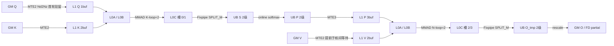

# flash_attn_npu_3 如何在 HeadDim=256 上分配内存与切块

> 范围：Ascend 950 / DAV_3510，`flash-attention-npu/csrc/ascend950/flash_attn_npu_3` 的 **FP16/BF16 非量化前向**。默认 QK HeadDim=256、V HeadDim=256、无独立 rope。FP8 / DN / Flash Decode combine 只在对照处点到，不展开。
>
> 核验基线：2026-11-05，本机 `flash-attention-npu` 提交 `2e5320494cb474365bacaf42c94abf0c7de0affc`，`ops-transformer` 提交 `75b6beb460eb32644a6c87fa5f9d76b756d17b4d`。本文为 Host tiling 与 kernel 源码的静态核对，未执行 CANN 编译或 NPU 数值/性能测试。
>
> 源码链接相对本文：npu_3 前缀 `../csrc/ascend950/flash_attn_npu_3/`，FIA/FAS 前缀 `../../ops-transformer/attention/`。
>
> “前面两个算子”指上一篇文档里的 [`fused_infer_attention_score`（FIA）](arch35-headdim-512-fia-fas.md) 与 [`flash_attention_score`（FAS）](arch35-headdim-512-fia-fas.md)。`csrc/ascend950/` 下只有 `flash_attn_npu_3` 与 `_4`，没有 `_1` / `_2`。

**当前主路径**：npu_3 在 D=256 **不做 D 轴 L1 分片**。Host 把 query 行数（含 GQA 合头）钳到 64、KV tile 固定 128，使每个 AIV 的一级 UB 缓冲恒为 32 KiB。D=128 与 D=256 走同一条 kernel 路径，只是 L1 里 Q/V 的预留槽变大。D>256 在 PyTorch 入口直接拒绝。对照 FIA/FAS：普通 FIA D=256 进不了 GQA 重构 kernel，与 FAS 共用 infer Cube，S1=128 / S2=128，BMM2 在 arch35 上通常写 GM。

## 0. 口径、缓冲预算与数据通路

### 0.1 统一口径

| 名称 | 本文含义 |
|---|---|
| D / DV | QK 归约宽度、V/输出宽度；本文主路径均为 256 |
| rowNum / M | 一次 Cube 任务的 query 行数 = `qSBlockSize × qNBlockSize`，含 GQA 合头；D=256 时上限 64 |
| S2 / kvBaseTile | 每轮处理的 KV 序列 tile；FP16/BF16 固定 128 |
| QK / Softmax / PV / Rescale | 分别对应 BMM1、Vec1、BMM2、Vec2 |
| PRE_LAUNCH=2 | KV 循环软流水深度；第 i 步发 QK(i)+Softmax(i)，同时做 PV(i-2)+Rescale(i-2) |
| KiB | 1024 字节；FP16/BF16 每元素 2 字节，FP32 累加每元素 4 字节 |

1 个 AIC 对应 2 个 AIV。QK / PV 的 Fixpipe 使用 `CopyL0CToUBMode::SPLIT_M`，按 8 对齐后对半拆行。[softmax 拆行](../csrc/ascend950/flash_attn_npu_3/online_softmax.hpp#L167)、[rescale 拆行](../csrc/ascend950/flash_attn_npu_3/rescale_o.hpp#L722)。

### 0.2 源码中的缓冲预算

| Buffer | 本文用到的容量 | 证据 |
|---|---|---|
| L1 | Host 写死 `ASCEND950_L1_SIZE = 512 KiB`；D=256 线性布局占用 480 KiB | [tiling 常量](../csrc/ascend950/flash_attn_npu_3/tiling.cpp#L32)、[kernel 基址](../csrc/ascend950/flash_attn_npu_3/fwd_kernel.cpp#L193) |
| L0A / L0B | 各按 `ArchTag::L0A/B_SIZE / L0_STAGES` ping-pong。硬件侧各 64 KiB | [QK 切槽](../csrc/ascend950/flash_attn_npu_3/qk_matmul.hpp#L141) |
| L0C | `L0C_PINGPONG_BUF_SIZE = ArchTag::L0C_SIZE / (L0_STAGES * 2)`；PV 偏移写死 `i+2`，与 QK 的 0/1 槽拼成四等分 | [QK L0C](../csrc/ascend950/flash_attn_npu_3/qk_matmul.hpp#L143)、[PV 偏移](../csrc/ascend950/flash_attn_npu_3/pv_matmul.hpp#L173) |
| UB | 主数据区按 32 KiB 栅格切到偏移 `7 × 32768`；标量区紧随其后 | [softmax 偏移](../csrc/ascend950/flash_attn_npu_3/online_softmax.hpp#L88)、[rescale 偏移](../csrc/ascend950/flash_attn_npu_3/rescale_o.hpp#L52) |

`Arch::Ascend950` 的完整常量不在本仓 vendored 的 [`catlass/arch/arch.hpp`](../csrc/catlass/include/catlass/arch/arch.hpp) 里（该文件只定义了 `AtlasA2`）。能从 kernel 直接推出的是：`pv_matmul` 把 PV 的 L0C 基址写成 `L0C_PINGPONG_BUF_SIZE * (i + 2)`，若 `L0_STAGES ≠ 2` 会与 QK 的 0/1 槽重叠，因此 **`L0_STAGES = 2`**。D=128 且 `rowNum=128` 时单槽至少要放下 `128×128×4 = 64 KiB`，四等分后整块 L0C 为 **256 KiB**，与 FIA/FAS 的 `l0cBufferManager.Init(..., 262144)` 一致。[FAS L0C 初始化](../../ops-transformer/attention/flash_attention_score/op_kernel/arch35/flash_attention_noquant_block_cube.h#L443)。

### 0.3 数据通路



Q 在任务开始时一次性搬进 L1 并驻留，直到该 query tile 的全部 KV tile 处理完。[loadQGM](../csrc/ascend950/flash_attn_npu_3/qk_matmul.hpp#L197)。V 在等待 Softmax 写完 P 之前就开始搬，注释写明“relavent instructions launched before p base tile crossCore wait”。[pv_matmul 文件头](../csrc/ascend950/flash_attn_npu_3/pv_matmul.hpp#L11)。

## 1. Host tiling：一张常量表，没有 D 分档搜索

入口把 HeadDim 限死在 `[1, 256]`，FP8 还要求恰好 128。超过 256 不会进入后面的切块逻辑。

源码摘录：[mha_fwd.cpp:L223-L240](../csrc/ascend950/flash_attn_npu_3/mha_fwd.cpp#L223)

```223:240:flash-attention-npu/csrc/ascend950/flash_attn_npu_3/mha_fwd.cpp
    TORCH_CHECK(head_size_q >= 1 && head_size_q <= 256, "FlashAttention supports q/k head dimensions in [1, 256]");
    TORCH_CHECK(head_size_v >= 1 && head_size_v <= 256, "FlashAttention supports value head dimensions in [1, 256]");
    // ...
    TORCH_CHECK(quantMode == 0 || (head_size_q == 128 && head_size_v == 128),
                "950 V3 FP8 requires Q/K/V head dimensions of 128");
```

D=256 时 Host 只改两件事：把 Q 的 S 向 tile 从 128 降到 64，并把 GQA 合头后的 M 轴上限同样压到 64。KV tile 仍是 128。

源码摘录：[tiling.cpp:L127-L153](../csrc/ascend950/flash_attn_npu_3/tiling.cpp#L127)

```127:153:flash-attention-npu/csrc/ascend950/flash_attn_npu_3/tiling.cpp
uint32_t FAInferTiling::GetQNBlockTile(uint32_t qSeqlen, uint32_t groupSize)
{
    uint32_t qRowNumCeil = Q_TILE_CEIL;
    uint32_t qNBlockTile = (qSeqlen != 0) ? (qRowNumCeil / qSeqlen) / N_SPLIT_HELPER * N_SPLIT_HELPER : Q_TILE_CEIL;
    if (faInfo_.embeddingSizeV > 128 && qSeqlen != 0) {
        constexpr uint32_t MAX_M_FOR_LARGE_D = Q_TILE_CEIL / 2U;
        uint32_t maxQNBlockTile = std::max(MAX_M_FOR_LARGE_D / qSeqlen, 1U);
        qNBlockTile = std::min(qNBlockTile, maxQNBlockTile);
    }
    // ...
}
uint32_t FAInferTiling::GetQSBlockTile(int64_t kvSeqlen)
{
    uint32_t qSBlockTile = faInfo_.embeddingSizeV > 128 ? 64 : Q_TILE_CEIL;
    return qSBlockTile;
}
uint32_t FAInferTiling::GetKSBlockTile(int64_t kvSeqlen)
{
    uint32_t kSBlockTile = faInfo_.dataType == DataType::FP8 ? 256U : 128U;
    return kSBlockTile;
}
```

`Q_TILE_CEIL = 128`。[常量](../csrc/ascend950/flash_attn_npu_3/tiling.cpp#L28)。因此 D=256 时：

| 轴 | 取值 | 作用 |
|---|---|---|
| `qBaseTile` | 64 | 每个任务覆盖的 Q 序列长度 |
| `kvBaseTile` | 128 | 每个任务覆盖的 KV 序列长度 |
| `qNBlockTile` | `min(groupSize, 64/qSeqlen)` | GQA 合进 M 轴，但 `rowNum ≤ 64` |
| 任务粒度 | `(B, N2, QS tile, QN tile)` | 核间按 `totalTaskNum` 轮询；FD 再沿 KV tile 二次切分 |

L1 tile 尺寸和 buffer 份数全部是字面量，不随 D 搜索。只有 Q 的 K 轴和 V 的 N 轴跟对齐后的 HeadDim 走。

源码摘录：[tiling.cpp:L184-L205](../csrc/ascend950/flash_attn_npu_3/tiling.cpp#L184)

```184:205:flash-attention-npu/csrc/ascend950/flash_attn_npu_3/tiling.cpp
    auto qBaseTile_ = GetQSBlockTile(faInfo_.maxKvSeqlen);
    const uint32_t quantMode = faInfo_.dataType == DataType::FP8 ? 1U : 0U;
    auto kvBaseTile_ = quantMode == 1 ? 256U : BASE_KV_SIZE;
    // ...
    auto qkL1TileM_ = Q_TILE_CEIL;
    auto qkL1TileKLeft_ = embeddingSizeAligned16_;
    auto qL1BufNum_ = 1;
    // K矩阵开启2buf，D按128分割，S2按256分割
    auto qkL1TileN_ = 256;
    auto qkL1TileKRight_ = quantMode == 1 ? 128 : 192;
    auto kL1BufNum_ = 2;
    // V矩阵开启db，D按128分割，kvBaseTile_不分割
    auto pvL1TileN_ = embeddingSizeVAligned16_;
    auto pvL1TileKLeft_ = kvBaseTile_;
    auto vL1BufNum_ = 2;
    // P矩阵在950上会常驻L1，由于基块的prelaunch为2，因此最好有3 buf
    auto pvL1TileM_ = Q_TILE_CEIL;
    auto pvL1TileKRight_ = kvBaseTile_;
    auto pL1BufNum_ = 3;
```

注释里的“D 按 128 分割、S2 按 256 分割”描述的是 **K 的 L1 预留槽**（`qkL1TileN=256`、`qkL1TileKRight=192`），不是运行时 KV tile。运行时 `kvBaseTile_=128`，QK 每次只往该槽写入 `align16(D) × 128`。

## 2. D=256 的片上内存

### 2.1 L1：480 KiB / 512 KiB，Q/K/P/V 线性拼接

kernel 先用 Host 下发的 tile 算出 PV 区起点，再按份数切片。

源码摘录：[fwd_kernel.cpp:L193-L198](../csrc/ascend950/flash_attn_npu_3/fwd_kernel.cpp#L193)

```193:198:flash-attention-npu/csrc/ascend950/flash_attn_npu_3/fwd_kernel.cpp
        auto pvL1AddrStart_ = qkL1TileM_ * qkL1TileKLeft_ * qL1BufNum_ * sizeof(ElementQ) +
                              qkL1TileKRight_ * qkL1TileN_ * kL1BufNum_ * sizeof(ElementK);
        for (uint32_t i = 0; i < pL1BufNum_; i++) {
            l1PTensor[i] = resource.l1Buf.template GetBufferByByte<ElementP>(
                pvL1AddrStart_ + pvL1TileM_ * pvL1TileKLeft_ * sizeof(ElementP) * i);
        }
```

Q/K 从 0 起分配，P/V 从 `pvL1AddrStart_` 起分配。[QK 构造](../csrc/ascend950/flash_attn_npu_3/qk_matmul.hpp#L159)、[PV 构造](../csrc/ascend950/flash_attn_npu_3/pv_matmul.hpp#L160)。D=256、FP16 的预留账：

| 区域 | 单份公式 | 单份 | 份数 | 合计 | L1 偏移 |
|---|---|---|---|---|---|
| Q | `128 × 256 × 2` | 64 KiB | 1 | 64 KiB | 0 |
| K | `192 × 256 × 2` | 96 KiB | 2 | 192 KiB | 64 KiB |
| P | `128 × 128 × 2` | 32 KiB | 3 | 96 KiB | 256 KiB |
| V | `128 × 256 × 2` | 64 KiB | 2 | 128 KiB | 352 KiB |
| **合计** | | | | **480 KiB** | 还剩 32 KiB |

同一套公式在 D=128 下只占 384 KiB。128→256 的增量是 Q +32 KiB、V +64 KiB；K 的 192 KiB 与 D 无关。

运行时活跃数据比预留更小：

- Q 实际只写 `rowNum × 256 × 2 ≤ 32 KiB`，因为 `qkL1TileM` 恒为 128，而 D=256 的 `rowNum ≤ 64`。[MakeCustomLayout](../csrc/ascend950/flash_attn_npu_3/qk_matmul.hpp#L177)
- K 每次写入 `256 × 128 × 2 = 64 KiB`，小于 96 KiB 预留。[QK 右矩阵 tile](../csrc/ascend950/flash_attn_npu_3/qk_matmul.hpp#L317)
- V 写入 `128 × 256 × 2 = 64 KiB`，与预留一致，全宽常驻，不切 D。[PV 右矩阵](../csrc/ascend950/flash_attn_npu_3/pv_matmul.hpp#L254)

### 2.2 UB：每 AIV 按 32 KiB 栅格，D=256 刚好填满 O_tmp

FP32 softmax 路径把 UB 切成固定 32 KiB 槽。kernel 与 epilogue 用同一套偏移。

源码摘录：[fwd_kernel.cpp:L214-L223](../csrc/ascend950/flash_attn_npu_3/fwd_kernel.cpp#L214)、[online_softmax.hpp:L88-L96](../csrc/ascend950/flash_attn_npu_3/online_softmax.hpp#L88)、[rescale_o.hpp:L52-L58](../csrc/ascend950/flash_attn_npu_3/rescale_o.hpp#L52)

```214:223:flash-attention-npu/csrc/ascend950/flash_attn_npu_3/fwd_kernel.cpp
            for (uint32_t i = 0; i < UB_S_OTMP_BUF_STAGES; i++) {
                ubSTensor[i] = resource.ubBuf.template GetBufferByByte<ElementS>(32768 * i);
            }
            for (uint32_t i = 0; i < UB_S_BUF_STAGES; i++) {
                ubOTmpTensor[i] = resource.ubBuf.template GetBufferByByte<ElementOTmp>(
                    4 * 32768 + rowNumPerSubCore * rescaleCol * sizeof(ElementOTmp) * i);
            }
```

| 偏移 | 内容 | 大小 |
|---|---|---|
| 0 / 32 KiB | S（QK 结果，fp32）2 级 | 2 × 32 KiB |
| 64 / 96 KiB | P（softmax 输出，fp16）2 级 | 2 × 32 KiB |
| 128 / 160 KiB | O_tmp（PV 结果，fp32）2 级 | 2 × 32 KiB |
| 192 KiB | 全局 O 累加器 | 32 KiB |
| 224 KiB+ | lm / gm / dm / ll / gl / mask | 各 64 个 float 量级 |

Fixpipe 按 M 对半拆给两个 AIV 后，每个 AIV 持有 `rowNum / 2` 行。乘积被设计成恒等于 32 KiB：

| HeadDim | `rowNum` 上限 | 每 AIV 行数 | 一级缓冲 |
|---|---|---|---|
| ≤128 | 128 | 64 | `64 × 128 × 4B = 32 KiB` |
| 256 | 64 | 32 | `32 × 256 × 4B = 32 KiB` |

这就是 `GetQSBlockTile` / `GetQNBlockTile` 在 `embeddingSizeV > 128` 时把 M 砍半的原因：若不砍，O_tmp 会变成 `64 × 256 × 4B = 64 KiB`，撑破 32 KiB 槽。向量侧也不再沿 D 循环，直接实例化全展开的 `SubCoreCompute<256>`。[rescale 分档](../csrc/ascend950/flash_attn_npu_3/rescale_o.hpp#L788)。

S、P 在 D=256 时实际更瘦（`32 × 128 × 4B = 16 KiB`、`32 × 128 × 2B = 8 KiB`），槽内有空闲。真正顶满 32 KiB 的是 O_tmp 和全局 O。

### 2.3 L0：QK 与 PV 各占 L0C 一半

```141:173:flash-attention-npu/csrc/ascend950/flash_attn_npu_3/qk_matmul.hpp
    static constexpr uint32_t L0A_PINGPONG_BUF_SIZE = ArchTag::L0A_SIZE / L0_STAGES;
    static constexpr uint32_t L0B_PINGPONG_BUF_SIZE = ArchTag::L0B_SIZE / L0_STAGES;
    static constexpr uint32_t L0C_PINGPONG_BUF_SIZE = ArchTag::L0C_SIZE / (L0_STAGES * 2);
```

```169:174:flash-attention-npu/csrc/ascend950/flash_attn_npu_3/pv_matmul.hpp
        for (uint32_t i = 0; i < L0_STAGES; i++) {
            l0ATensor[i] = resource.l0ABuf.template GetBufferByByte<ElementA>(L0A_PINGPONG_BUF_SIZE * i);
            l0BTensor[i] = resource.l0BBuf.template GetBufferByByte<ElementB>(L0B_PINGPONG_BUF_SIZE * i);
            l0CTensor[i] =
                resource.l0CBuf.template GetBufferByByte<ElementAccumulator>(L0C_PINGPONG_BUF_SIZE * (i + 2));
        }
```

D=256 时 Cube 指令 tile 仍是 `128×128×128`。[L0TileShape](../csrc/ascend950/flash_attn_npu_3/fwd_kernel.cpp#L999)。D 轴只在 L0 循环里切开，L1 保持全宽：

| 矩阵 | L0 循环 | D=256 次数 | 单次 L0C 结果 |
|---|---|---|---|
| QK | `kL0LoopNum = CeilDiv(D, 128)`，N 向 1 次 | 2 | `64 × 128 × 4B = 32 KiB` |
| PV | `nL0LoopNum = CeilDiv(D, 128)`，K 向 1 次 | 2 | `64 × 128 × 4B = 32 KiB`，按列偏移 `nL0Itr × 128` 写入 UB |

[QK 三维循环](../csrc/ascend950/flash_attn_npu_3/qk_matmul.hpp#L299)、[PV 三维循环](../csrc/ascend950/flash_attn_npu_3/pv_matmul.hpp#L411)。K 在 L0 上按 128 宽累加（`initMmad = (kL0Itr == 0)`）；V 在 L1 全宽常驻，只在 L0 的 N 向切两刀。这与 FIA/FAS 在 D>256 时“L1 只留 128 宽 slab”不是同一层切分。

### 2.4 GM workspace：片上闭环，非 FD 仍预留了死分配

非 Flash Decode 路径 Host 仍按核数申请四块 workspace：

```227:231:flash-attention-npu/csrc/ascend950/flash_attn_npu_3/tiling.cpp
    uint64_t qkOutSize = static_cast<uint64_t>(blockNum_) * WORKSPACE_BLOCK_SIZE_DB * SIZE_OF_32BIT * PRELANCH_NUM;
    uint64_t smOnlineOutSize =
        static_cast<uint64_t>(blockNum_) * WORKSPACE_BLOCK_SIZE_DB * SIZE_OF_16BIT * PRELANCH_NUM;
    uint64_t pvOutSize = static_cast<uint64_t>(blockNum_) * WORKSPACE_BLOCK_SIZE_DB * SIZE_OF_32BIT * PRELANCH_NUM;
    uint64_t UpdateSize = static_cast<uint64_t>(blockNum_) * WORKSPACE_BLOCK_SIZE_DB * SIZE_OF_32BIT * PRELANCH_NUM;
```

`WORKSPACE_BLOCK_SIZE_DB = 128 × 512`，`PRELANCH_NUM = 3`。[常量](../csrc/ascend950/flash_attn_npu_3/tiling.cpp#L29)。每核约 `65536 × (4+2+4+4) × 3 = 2.625 MiB`。前向 kernel 只把 workspace 当成 FD 的 partial LSE / O；QK、Softmax、PV、Rescale 都在片上。FD 路径明确把这四块置 0，并注释 “keeps QK, softmax, PV and rescale buffers on chip”。[FD 清零](../csrc/ascend950/flash_attn_npu_3/tiling.cpp#L544)。非 FD 路径同样全在片上，却没有置 0。

## 3. Cube / Vector 交互与流水

### 3.1 三级软流水

```47:50:flash-attention-npu/csrc/ascend950/flash_attn_npu_3/fwd_kernel.cpp
static constexpr uint32_t PRE_LAUNCH = 2;
static constexpr uint32_t MAX_CROSS_CORE_BUF_STAGES = PRE_LAUNCH + 1;
static constexpr uint32_t UB_S_OTMP_BUF_STAGES = 2;
static constexpr uint32_t UB_S_BUF_STAGES = 2;
```

KV 循环写成 `kvSLoopCount + PRE_LAUNCH`。[主循环](../csrc/ascend950/flash_attn_npu_3/fwd_kernel.cpp#L599)。前 `kvSLoopCount` 步发 QK+Softmax；从第 `PRE_LAUNCH` 步起叠加滞后 2 拍的 PV+Rescale。P 因此需要 3 份 L1，避免基块之间互相堵住。

| 拍 | AIC | AIV |
|---|---|---|
| i | QK(i)：K 搬 L1 → MMAD → Fixpipe 到 UB S | Softmax(i)：S → P，再写 L1 P |
| i | 提前搬 V(i-2) 进 L1 | |
| i | 等 Softmax(i-2) 后做 PV(i-2)，Fixpipe 到 UB O_tmp | Rescale(i-2)：O_tmp 更新全局 O，最后一拍写出 |

跨核同步是 mode 4：AIC 侧每个 flag 再复制一份 `id+16` 给第二个 AIV。[QK Set/Wait](../csrc/ascend950/flash_attn_npu_3/qk_matmul.hpp#L220)、[初始 flag](../csrc/ascend950/flash_attn_npu_3/fwd_kernel.cpp#L780)。同核管道用 `MTE1_MTE2`（Q/K/V）、`M_MTE1`（L0A/L0B）、`FIX_M`（L0C）以及 Vector 侧的 `V_MTE2` / `MTE3_V`。

### 3.2 一次 KV tile 的搬运顺序

1. **任务开头**：`loadQGM` 把当前 query tile 的全部 head 按 Nd2Nz 写入 L1 Q，之后只读不换。[loadQGM](../csrc/ascend950/flash_attn_npu_3/qk_matmul.hpp#L197)
2. **QK**：按当前 KV tile 搬 K（paged 走 `blockTables`，NZ 走专用 `DataCopy`），L0 上对 D 做两次 128 宽 MMAD 累加，Fixpipe 前先等 AIV 释放 UB S。[QK operator](../csrc/ascend950/flash_attn_npu_3/qk_matmul.hpp#L270)
3. **Softmax**：两个 AIV 各拿一半行，在 UB 上做 online softmax / mask / softcap，再 `CopyPUbToPL1` 把 P 写成 L1 的 zN。[softmax](../csrc/ascend950/flash_attn_npu_3/online_softmax.hpp#L158)、[P 回写](../csrc/ascend950/flash_attn_npu_3/online_softmax.hpp#L117)
4. **PV**：V 的 MTE2 在 `WaitCrossCoreSync(softmaxReadyFlag)` 之前发出；P 就绪后做两次 128 宽 N 向 MMAD，Fixpipe 到 UB O_tmp。[PV operator](../csrc/ascend950/flash_attn_npu_3/pv_matmul.hpp#L230)
5. **Rescale**：按 `dm` 缩放旧 O、累加新 O_tmp；最后一拍写 GM O 或 FD partial。[rescale](../csrc/ascend950/flash_attn_npu_3/rescale_o.hpp#L705)

## 4. 和 FIA / FAS 在 D=256 上的区别

对照口径：npu_3 取本文主路径（FP16、D=DV=256、非 FD）。FIA 取普通非量化 GQA D=256——重构模板的能力门禁要求 `qkHeadDim == 128`（或 Prefill MLA），普通 D=256 进不了 `FANoQuantGqaBlockCube`，而是落到与 FAS 共用的 infer Cube。[GQA 门禁](../../ops-transformer/attention/fused_infer_attention_score/op_host/arch35/fia_tiling_nonquant_gqa.cpp#L154)、[Aligned256 共用 Cube](../../ops-transformer/attention/flash_attention_score/op_kernel/arch35/flash_attention_noquant_block_cube.h#L162)。FAS 取 arch35 训练前向，D 模板 `ALIGNED_256`。[FAS D 分档](../../ops-transformer/attention/flash_attention_score/op_host/arch35/flash_attention_score_tiling_basic.cpp#L73)。

| 项目 | npu_3 | 普通 FIA D=256（兜底 infer） | FAS 训练 D=256 |
|---|---|---|---|
| 决策方式 | Host 常量表，kernel 一条路径 | D 编进 `DTemplateType`，`if constexpr (dBaseSize <= 256)` 走全宽 L1 | 同左，D=256 选 `ALIGNED_256` |
| Cube S1 / M | 64（含 GQA 合头） | Host `sOuter=64` × `cvRatio=2` → Cube 128 | 128 |
| Cube S2 | 128 | 128 | 128 |
| L1 是否切 D | 否，Q/K/V 全宽 | 否，`isSplitL1` 只在 `dBaseSize > 256` 或 FP32 | 同左 |
| K/V L1 buffer | 各 2 份 | 全宽 + DB（S2=128 时） | 全宽 + DB |
| BMM2 落点 | 永远 L0C→UB | arch35 `GetC2Position`：D=256 默认 GM | `GetC2PositionForTrain`：`≤256` 走 UB |
| Vec2 是否切行 | 否，`SubCoreCompute<256>` 一次吃完 | 写 GM 时按 `8192/dBasicBlock` 分行 | 训练态 D=256 不走 `splitD` |
| 流水深度 | `PRE_LAUNCH=2` | 共用 infer 流水；GQA 重构才是 `PRELOAD_N=3` | `runInfo[taskId & 3]` 四级错位 |
| D>256 | 入口拒绝 | L1 切 `l1BaseD=128`，BMM2 写 GM | D 模板直接升到 `ALIGNED_768` |

### 4.1 tiling 哲学

npu_3 把“D≤256”当成单一场景：用减小 M 保住 32 KiB UB 不变量，换一条无需分档的 kernel。FIA/FAS 把 D=256 放进可扩到 512/576/768 的模板体系，D>256 才启用 L1 切 D。[FIA 全宽分支](../../ops-transformer/attention/fused_infer_attention_score/op_kernel/arch35/fia_block_cube_noquant_gqa.h#L148)、[FAS isSplitL1](../../ops-transformer/attention/flash_attention_score/op_kernel/arch35/flash_attention_noquant_block_cube.h#L162)。

### 4.2 为什么 npu_3 能在 D=256 保住 UB，而 FAS infer 常常写 GM

npu_3 的 O_tmp 按 **每 AIV 32 行 × 256** 规划，32 KiB 刚好。FAS/FIA 共用 infer 的 Cube S1=128，若整块 `128 × 256 × 4B = 128 KiB` 再对半给 AIV，单 AIV 仍是 64 KiB，已经超过 npu_3 那条 32 KiB 栅格；arch35 的 `GetC2Position` 对 `Aligned256` 默认返回 GM。[GetC2Position](../../ops-transformer/attention/common/op_kernel/arch35/flash_attention_score_common_regbase_arch35.h#L238)。训练态另走 `GetC2PositionForTrain`，`≤256` 才留 UB。[训练落点](../../ops-transformer/attention/common/op_kernel/arch35/flash_attention_score_common_regbase_arch35.h#L250)。

### 4.3 GQA 合轴

npu_3 把多个 q head 塞进 M 轴来填满 64 行，`qNBlockTile` 与 `qSBlockSize` 联动。[GetQNBlockTile](../csrc/ascend950/flash_attn_npu_3/tiling.cpp#L127)。FAS 不做这件事。FIA GQA 重构有合轴，但当前 Host 不接受普通 D=256。

### 4.4 能力边界

npu_3 用 D≤256 换来同一 kernel 内闭环的 paged KV、NZ cache、Flash Decode 切 KV + combine、SWA、softcap、LSE。FIA/FAS 是 CANN 注册算子，靠 D 轴分片走到 512/576/768，见 [FIA/FAS 文档](arch35-headdim-512-fia-fas.md)。

## 5. 文件速查

| 文件 | 本文用到的内容 |
|---|---|
| [tiling.cpp](../csrc/ascend950/flash_attn_npu_3/tiling.cpp) | S1/S2/L1 tile、workspace、FD 调度 |
| [tilingdata.h](../csrc/ascend950/flash_attn_npu_3/tilingdata.h) | Host→Device 字段 |
| [mha_fwd.cpp](../csrc/ascend950/flash_attn_npu_3/mha_fwd.cpp) | HeadDim 门禁、workspace 申请 |
| [fwd_kernel.cpp](../csrc/ascend950/flash_attn_npu_3/fwd_kernel.cpp) | 主循环、L1/UB 基址、`PRE_LAUNCH`、模板形状 |
| [qk_matmul.hpp](../csrc/ascend950/flash_attn_npu_3/qk_matmul.hpp) | Q 驻留、K 搬运、QK MMAD、Fixpipe |
| [pv_matmul.hpp](../csrc/ascend950/flash_attn_npu_3/pv_matmul.hpp) | V 提前搬、PV MMAD、L0C `i+2` |
| [online_softmax.hpp](../csrc/ascend950/flash_attn_npu_3/online_softmax.hpp) | UB S/P 布局、拆行、P 回 L1 |
| [rescale_o.hpp](../csrc/ascend950/flash_attn_npu_3/rescale_o.hpp) | UB O 布局、`SubCoreCompute<256>`、FD partial |
| [kernel_common.hpp](../csrc/ascend950/flash_attn_npu_3/kernel_common.hpp) | device 侧 `GetQNBlockTile` |

## 6. 小结

1. npu_3 支撑 D=256 的核心不是切 D，而是 **把 M 从 128 收到 64**，让“每 AIV 一级缓冲 = 32 KiB”在 D=128 与 D=256 上同时成立。[GetQSBlockTile](../csrc/ascend950/flash_attn_npu_3/tiling.cpp#L146)
2. L1 按 Q(1) / K(2) / P(3) / V(2) 线性排布，D=256 预留 480 KiB；Q 驻留、K/V double buffer、P 三级软流水。[L1 基址](../csrc/ascend950/flash_attn_npu_3/fwd_kernel.cpp#L193)
3. D 轴只在 L0 出现：QK 做两次 K 向 128 累加，PV 做两次 N 向 128 Fixpipe；V 在 L1 全宽。[PV N 循环](../csrc/ascend950/flash_attn_npu_3/pv_matmul.hpp#L411)
4. QK / Softmax / PV / Rescale 全部 L0C↔UB，不经过 GM；非 FD 的四块 workspace 是死预留。[FD 注释](../csrc/ascend950/flash_attn_npu_3/tiling.cpp#L544)
5. 与 FIA/FAS 的差别可以收成一句：npu_3 用更小的 M 换一条不分档、BMM2 常驻 UB 的推理 kernel；FIA/FAS 用更大的 S1 和 D 模板体系换 D=512 能力，D=256 时普通 FIA 已与 FAS infer 共用 Cube，arch35 上 BMM2 默认落 GM。
