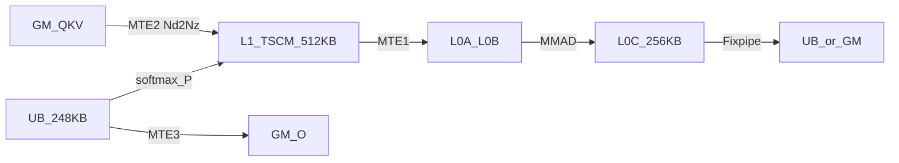
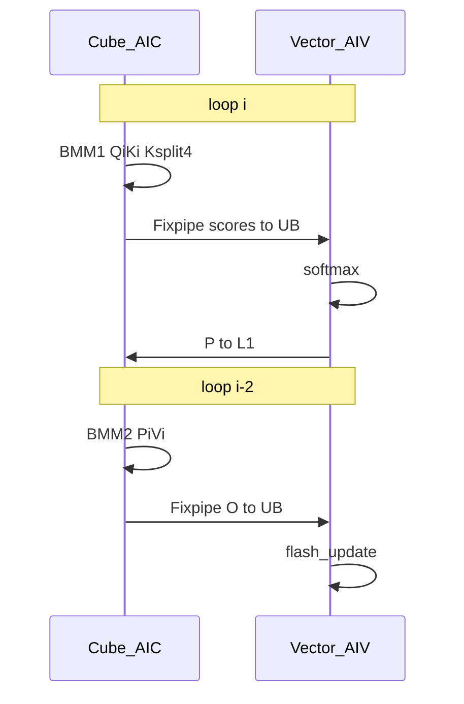

# FIA / FAS 如何在 arch35 上支撑 HeadDim 512

> 范围：`fused_infer_attention_score`（FIA，推理）与 `flash_attention_score`（FAS，训练）在 DAV_3510 / arch35（Ascend 950PR&950DT）上的非量化路径。  
> 口径：以 tiling / kernel 硬约束为准。下文每条结论都附 **可点击跳转的源码证据**（Ctrl/Cmd + 点击链接，或点代码块路径）。

**一句话**：512 能放下，不是把整块 `S×512` 塞进 L1/UB，而是沿 D 切 128 宽 slab；FIA 用更小的 S1 把整行 O 留在 L0C/UB，FAS 把 BMM2 写 GM 再按 16 行切 Vector。MLA 把 64 维 rope 拼进 QK=576，避免第二次 matmul。

路径前缀（相对本文件）：`../../ops-transformer/attention/`。

---

## 0. 硬件与数据通路

DAV_3510 / arch35 关键预算（与代码硬编码一致）：

| Buffer | 代码硬编码 | 证据 |
|--------|------------|------|
| L1 (TSCM) | `524288` = 512 KB | [fia_kernel_noquant_gqa.h#L171](../../ops-transformer/attention/fused_infer_attention_score/op_kernel/arch35/fia_kernel_noquant_gqa.h#L171) |
| L0A / L0B | `65536` = 64 KB | [fia_block_cube_noquant_gqa.h#L169-L170](../../ops-transformer/attention/fused_infer_attention_score/op_kernel/arch35/fia_block_cube_noquant_gqa.h#L169) |
| L0C | `262144` = 256 KB | [fia_block_cube_noquant_gqa.h#L171](../../ops-transformer/attention/fused_infer_attention_score/op_kernel/arch35/fia_block_cube_noquant_gqa.h#L171) |

```169:174:../../ops-transformer/attention/fused_infer_attention_score/op_kernel/arch35/fia_block_cube_noquant_gqa.h
        l0aBufferManager.Init(tPipe, 65536);  // 64 * 1024
        l0bBufferManager.Init(tPipe, 65536);  // 64 * 1024
        l0cBufferManager.Init(tPipe, 262144); // 256 * 1024
        // L0A B C当前写死，要改成通过计算获取
        mmL0ABuffers.Init(l0aBufferManager, 32 * 1024);
        mmL0BBuffers.Init(l0bBufferManager, 32 * 1024);
```

```171:176:../../ops-transformer/attention/fused_infer_attention_score/op_kernel/arch35/fia_kernel_noquant_gqa.h
        l1BufferManager.Init(pipe, 524288); // 512 * 1024
        // 保存p结果的L1内存必须放在第一个L1 policy上，保证和vec申请的地址相同
        l1PBuffers.Init(l1BufferManager, mm2LeftSize);
        ubBufferManager.Init(pipe, mm1ResultSize * 2 + mm2ResultSize * 2);
        bmm2Buffers.Init(ubBufferManager, mm2ResultSize);
        bmm1Buffers.Init(ubBufferManager, mm1ResultSize);
```

新增 **L0C→UB Fixpipe**、**UB→L1**；Cube:Vector 典型 **1:2**（`CV_RATIO=2`）。Softmax 只在 **S1×S2** 上做，D 的压力在 Q/K/V 驻留、BMM2 累加和 flash-update。



---

## 1. 共同策略：D > 256 沿 `l1BaseD=128` 切分

### 结论

D=512 时 K/V 不全宽常驻 L1，而是每次只搬 `S2 × 128`；BMM1 做 K-loop（512/128=4），在 L0C 累加。

### 证据 A：`l1BaseD = 128` 常量

[fia_block_cube_noquant_gqa.h#L73](../../ops-transformer/attention/fused_infer_attention_score/op_kernel/arch35/fia_block_cube_noquant_gqa.h#L73)

```73:73:../../ops-transformer/attention/fused_infer_attention_score/op_kernel/arch35/fia_block_cube_noquant_gqa.h
    static constexpr uint32_t l1BaseD = 128;
```

FAS 同源：FP16 时 `l1BaseD = 128`。  
[flash_attention_noquant_block_cube.h#L196-L197](../../ops-transformer/attention/flash_attention_score/op_kernel/arch35/flash_attention_noquant_block_cube.h#L196)

```196:197:../../ops-transformer/attention/flash_attention_score/op_kernel/arch35/flash_attention_noquant_block_cube.h
    static constexpr uint32_t l1BaseD =
        isFp8 ? 256 : ((IsSameType<INPUT_T, float>::value) ? (dBaseSize > 128 ? 64 : 128) : 128);
```

### 证据 B：D>256 时 L1 右矩阵按 `l1BaseD` 开缓冲（不是全宽 D）

注释写明「L1 切 D 轴」；K/V size = `s2BaseSize * l1BaseD`。  
[fia_block_cube_noquant_gqa.h#L155-L165](../../ops-transformer/attention/fused_infer_attention_score/op_kernel/arch35/fia_block_cube_noquant_gqa.h#L155)

```155:165:../../ops-transformer/attention/fused_infer_attention_score/op_kernel/arch35/fia_block_cube_noquant_gqa.h
        } else {
            /* D大于256的其他dtype场景，Bmm1左矩阵不开DB + 驻留 + 复用 + L1切K
            Bmm2左矩阵3 Buffer循环，Bmm1右矩阵和Bmm2右矩阵在L1上切D轴，并开启DoubleBuffer
            唯一不同的是D=256场景下的D轴只能切分到96，其余都可以切分到128，原因是D=256场景S1Base是128
            */
            constexpr uint32_t mm1LeftSize = mBaseSize * dBaseSize * sizeof(Q_T);
            constexpr uint32_t mm1RightSize = s2BaseSize * l1BaseD * sizeof(KV_T);
            constexpr uint32_t mm2RightSize = s2BaseSize * l1BaseD * sizeof(KV_T);
            l1QBuffers.Init((*l1BufferManagerPtr), mm1LeftSize);
            l1KBuffers.Init((*l1BufferManagerPtr), mm1RightSize);
            l1VBuffers.Init((*l1BufferManagerPtr), mm2RightSize);
        }
```

FAS 同样在 `isSplitL1 = (dBaseSize > 256)` 时走该路径。  
[flash_attention_noquant_block_cube.h#L162](../../ops-transformer/attention/flash_attention_score/op_kernel/arch35/flash_attention_noquant_block_cube.h#L162) · [L411-L423](../../ops-transformer/attention/flash_attention_score/op_kernel/arch35/flash_attention_noquant_block_cube.h#L411)

```162:167:../../ops-transformer/attention/flash_attention_score/op_kernel/arch35/flash_attention_noquant_block_cube.h
    static constexpr bool isSplitL1 = (dBaseSize > 256) || (IsSameType<INPUT_T, float>::value);
    static constexpr bool useBankManager = !isSplitL1 && (CV_RATIO == 1) && !isInfer;
    using BuffMgrType = typename NoQuantCube::BufferManagerSel<useBankManager>::Type;
    BuffMgrType* l1BufferManagerPtr;
    using L1PBuffType = typename NoQuantCube::L1PBuffSel<CV_RATIO, isInfer>::Type;
    static constexpr bool splitD = (uint16_t)dVTemplateType > (uint16_t)DTemplateType::Aligned256;
```

### 证据 C：BMM1 入口在 D>256 时走 `IterateBmm1NdL1SplitK`

[fia_block_cube_noquant_gqa.h#L345-L352](../../ops-transformer/attention/fused_infer_attention_score/op_kernel/arch35/fia_block_cube_noquant_gqa.h#L345)

```345:352:../../ops-transformer/attention/fused_infer_attention_score/op_kernel/arch35/fia_block_cube_noquant_gqa.h
    __aicore__ inline void IterateBmm1(MM1_DBUF_T& outputBuf, RunInfoX& runInfo)
    {
        if constexpr (dBaseSize > 256) {
            IterateBmm1NdL1SplitK(outputBuf, runInfo);
            return;
        }

        IterateBmm1NdL0Split(outputBuf, runInfo);
    }
```

### 证据 D：K-loop = `ceil(dSize / 128)`，首 S2 搬 Q 切片，之后复用

[fia_block_cube_noquant_gqa.h#L431-L477](../../ops-transformer/attention/fused_infer_attention_score/op_kernel/arch35/fia_block_cube_noquant_gqa.h#L431)

```431:477:../../ops-transformer/attention/fused_infer_attention_score/op_kernel/arch35/fia_block_cube_noquant_gqa.h
    /* 针对S1Base=128, S2Base = 128, D > 256场景，L1层面切K，且左矩阵单Buffer+驻留，右矩阵每次重新搬运。*/
    __aicore__ inline void IterateBmm1NdL1SplitK(MM1_DBUF_T& outputBuf, RunInfoX& runInfo)
    {
        constexpr uint32_t baseK = l1BaseD;
        uint32_t kLoops = (constInfo.dSize + baseK - 1) / baseK;
        // ...
        for (uint32_t k = 0; k < kLoops; k++) {
            // ...
            if (unlikely(runInfo.isFirstS2Loop)) {
                CopyQuerySlice(mm1ATensor[k * l1BaseKOffset], k * baseK, realK, runInfo);
            } else {
                mm1A = l1QBuffers.GetPre();  // 非首 S2：复用 Q
            }
            CopyKeySlice(mm1BTensor, k * baseK, realK, runInfo);
            MatmulFull</* ... baseK ... */>(...);
        }
```

D=512 → `kLoops = 4`。

### 反证：`flash_attn` 模板不到 512

[flash_attn_tiling.cpp#L86-L104](../../ops-transformer/attention/flash_attn/op_host/arch35/flash_attn_tiling.cpp#L86) 只映射 64 / 72 / 128 / 256 和 (192,128)，没有 512 档。

```86:104:../../ops-transformer/attention/flash_attn/op_host/arch35/flash_attn_tiling.cpp
        if (faInfo_->qkHeadDim == 64) {
            tilingKeyInfo_.config = (sOuterFactor_ == 64) ? 0 : 1;
        } else if (faInfo_->qkHeadDim == 128) {
            tilingKeyInfo_.config = (sOuterFactor_ == 64) ? 2 : 3;
        } else if (faInfo_->qkHeadDim == 72) {
            tilingKeyInfo_.config = (sOuterFactor_ == 64) ? 8 : 9;
        } else if (faInfo_->qkHeadDim == 256) {
            tilingKeyInfo_.config = (sOuterFactor_ == 64) ? 4 : 5;
        }
    } else {
        if (faInfo_->qkHeadDim == 192 && faInfo_->vHeadDim == 128) {
            tilingKeyInfo_.config = (sOuterFactor_ == 64) ? 6 : 7;
        }
    }
```

```text
GM Q/K/V
  │ Nd2Nz, D-offset = k * 128
  ▼
L1  Q[S1 × 512 resident] | K,V[S2 × 128 DB] | P[S1 × S2 × 3]
  │
  ├─ BMM1: 4 × (Q[:,128] · K[:,128]) acc L0C ──Fixpipe──► UB scores ──softmax──► P
  └─ BMM2: P · V
           FIA: L0C 64×512 ──UB──► flash-update ──GM O
           FAS: L0C 128×128 ──GM──► Vec2 16×512 ──GM O
```

---

## 2. FIA GQA D=512：S1=64 + BMM2 写 UB

### 2.1 Host：vHeadDim>128 时切 S1=64 / S2=128

[fia_tiling_nonquant_gqa.cpp#L322-L350](../../ops-transformer/attention/fused_infer_attention_score/op_host/arch35/fia_tiling_nonquant_gqa.cpp#L322)

```322:350:../../ops-transformer/attention/fused_infer_attention_score/op_host/arch35/fia_tiling_nonquant_gqa.cpp
void FiaTilingNonQuantArch35::AdjustSinnerAndSouter()
{
    sOuterFactor_ = SOUTER_64;
    sInnerFactor_ = SINNER_128;
    // ...
    } else if (fiaInfo_->vHeadDim > DSIZE_128 && fiaInfo_->mlaMode != MlaMode::ROPE_SPLIT_D512 &&
               fiaInfo_->s1Size != 1) {
        if (checkQueryAndValueS && fiaInfo_->vHeadDim <= DSIZE_256) {
            sOuterFactor_ = SOUTER_32;
            sInnerFactor_ = SINNER_256;
        } else {
            sOuterFactor_ = SOUTER_64;   // D=512 走这里
            sInnerFactor_ = SINNER_128;
        }
```

Config 表含 `DAligned512_DVAligned512`：  
[fia_tiling_nonquant_gqa.cpp#L62-L63](../../ops-transformer/attention/fused_infer_attention_score/op_host/arch35/fia_tiling_nonquant_gqa.cpp#L62) · [#L78-L79](../../ops-transformer/attention/fused_infer_attention_score/op_host/arch35/fia_tiling_nonquant_gqa.cpp#L78)

### 2.2 分发：`isReconstructTemp` → GQA / MLA 新 kernel

[fia_arch35_noquant.h#L88-L98](../../ops-transformer/attention/fused_infer_attention_score/op_kernel/arch35/fia_arch35_noquant.h#L88)

```88:98:../../ops-transformer/attention/fused_infer_attention_score/op_kernel/arch35/fia_arch35_noquant.h
    if constexpr (isReconstructTemp == true) {
        if constexpr (config == Config_S1Aligned64_S2Aligned128_DAligned576_DVAligned512 && hasRope) {
            run_fia_noquant_mla_kernel<half, half, ...>(...);
        } else {
            run_fia_noquant_gqa_kernel<half, half, ...>(...);
        }
```

回退路径（`isReconstructTemp=false` + `Aligned512`）走 FAS 同源 infer kernel：  
[fia_arch35_noquant.h#L115-L125](../../ops-transformer/attention/fused_infer_attention_score/op_kernel/arch35/fia_arch35_noquant.h#L115)

### 2.3 L1 / UB：P 必须是第一个 L1 policy；BMM2 Fixpipe 写 UB

- `BMM2_FIXPIPE_CONFIG` 明确 `bmm2Write2Ub = true`  
  [fia_block_cube_noquant_gqa.h#L77](../../ops-transformer/attention/fused_infer_attention_score/op_kernel/arch35/fia_block_cube_noquant_gqa.h#L77)

```77:77:../../ops-transformer/attention/fused_infer_attention_score/op_kernel/arch35/fia_block_cube_noquant_gqa.h
    static constexpr FixpipeConfig BMM2_FIXPIPE_CONFIG = {CO2Layout::ROW_MAJOR, true}; // true: bmm2Write2Ub
```

- P 三缓冲 + BMM1/BMM2 UB DB：  
  [fia_kernel_noquant_gqa.h#L48](../../ops-transformer/attention/fused_infer_attention_score/op_kernel/arch35/fia_kernel_noquant_gqa.h#L48) · [#L67-L69](../../ops-transformer/attention/fused_infer_attention_score/op_kernel/arch35/fia_kernel_noquant_gqa.h#L67)

```48:69:../../ops-transformer/attention/fused_infer_attention_score/op_kernel/arch35/fia_kernel_noquant_gqa.h
    static constexpr uint32_t PRELOAD_N = 3; // C1 C1 C1 C2
    // ...
    BuffersPolicyDB<BufferType::UB, SyncType::CROSS_CORE_SYNC_BOTH> bmm1Buffers;
    BuffersPolicyDB<BufferType::UB, SyncType::CROSS_CORE_SYNC_BOTH> bmm2Buffers;
    BuffersPolicy3buff<BufferType::L1, SyncType::CROSS_CORE_SYNC_FORWARD> l1PBuffers;
```

### 2.4 BMM2：`dV > 128` 用 `MatmulN` 按 N=128 切，结果 Fixpipe 到 UB

[fia_block_cube_noquant_gqa.h#L571-L588](../../ops-transformer/attention/fused_infer_attention_score/op_kernel/arch35/fia_block_cube_noquant_gqa.h#L571)

```571:588:../../ops-transformer/attention/fused_infer_attention_score/op_kernel/arch35/fia_block_cube_noquant_gqa.h
        if constexpr ((uint32_t)dVTemplateType > 128) {
            MatmulN<Q_T, KV_T, T, mBaseSize, 128, s2BaseSize, ABLayout::MK, ABLayout::KN>(
                mm2A.GetTensor<Q_T>(), mm2BTensor, mmL0ABuffers, mmL0BBuffers, mm2ResL0C.GetTensor<T>(), param);
        } else {
            // ...
        }
        // ...
        FixpipeMm2PartialN(outputBuf.template GetTensor<T>(), mm2ResL0C.GetTensor<T>(), constInfo.dSizeV, runInfo);
```

S1=64 时 `64×512×4 = 128 KB = L0C/2`，可 ping-pong，故能整行写 UB。

### 2.5 Vec2：不切 D，整行在 UB 上 flash-update

[fia_block_vec_noquant_gqa.h#L411-L454](../../ops-transformer/attention/fused_infer_attention_score/op_kernel/arch35/fia_block_vec_noquant_gqa.h#L411)

```411:454:../../ops-transformer/attention/fused_infer_attention_score/op_kernel/arch35/fia_block_vec_noquant_gqa.h
    __aicore__ inline void ProcessVec2(mm2ResPos& bmm2ResBuf, RunInfoX runInfo)
    {
        bmm2ResBuf.WaitCrossCore();
        ProcessVec2OnUb(bmm2ResBuf, runInfo);
        return;
    }

    __aicore__ inline void ProcessVec2OnUb(...)
    {
        int64_t vec2CalcSize = runInfo.actVecMSize * dTemplateAlign64;
        // FlashUpdateNew / FlashUpdateLastNew 直接对整行 D 做
        // ...
        CopyOutAttentionOut(runInfo, vec2ResUb, 0, runInfo.actVecMSize);
    }
```

### 2.6 流水：`PRELOAD_N=3`，当前 loop 做 C1，loop-2 做 C2

[fia_kernel_noquant_gqa.h#L522-L543](../../ops-transformer/attention/fused_infer_attention_score/op_kernel/arch35/fia_kernel_noquant_gqa.h#L522)

```522:543:../../ops-transformer/attention/fused_infer_attention_score/op_kernel/arch35/fia_kernel_noquant_gqa.h
    __aicore__ inline void ExecuteTask(uint64_t loop, RunInfoX taskRunInfo[PRELOAD_N])
    {
        RunInfoX& runInfo0 = taskRunInfo[loop % PRELOAD_N];
        RunInfoX& runInfoNegN = taskRunInfo[(loop - (PRELOAD_N - 1)) % PRELOAD_N];
        if (runInfo0.isValid) {
            if ASCEND_IS_AIC { ComputeMm1(runInfo0); }
            else { ComputeVec1(runInfo0); }
        }
        if (loop >= (PRELOAD_N - 1)) {
            if (runInfoNegN.isValid) {
                if ASCEND_IS_AIC { ComputeMm2(runInfoNegN); }
                else { ComputeVec2(runInfoNegN); }
            }
        }
    }
```



---

## 3. FIA Decode MLA：QK=576，V=512

### 3.1 能力门禁：qk=512 + rope=64 + v=512

[fia_tiling_nonquant_mla.cpp#L95-L98](../../ops-transformer/attention/fused_infer_attention_score/op_host/arch35/fia_tiling_nonquant_mla.cpp#L95)

```95:98:../../ops-transformer/attention/fused_infer_attention_score/op_host/arch35/fia_tiling_nonquant_mla.cpp
    // MLA D512 维度约束
    if (fiaInfo_->qkHeadDim != DSIZE_512 || fiaInfo_->ropeHeadDim != MLA_ROPE_D_DIM_64 ||
        fiaInfo_->vHeadDim != DSIZE_512) {
        return false;
```

### 3.2 固定切分：sOuter=32（×cvRatio→64），sInner=128

[fia_tiling_nonquant_mla.cpp#L263-L267](../../ops-transformer/attention/fused_infer_attention_score/op_host/arch35/fia_tiling_nonquant_mla.cpp#L263)

```263:267:../../ops-transformer/attention/fused_infer_attention_score/op_host/arch35/fia_tiling_nonquant_mla.cpp
void FiaTilingNonQuantMlaArch35::AdjustSinnerAndSouter()
{
    // MLA D512 固定切分大小
    sOuterFactor_ = SOUTER_32;
    sInnerFactor_ = SINNER_128;
```

### 3.3 Q L1 按 576 开；KV/P 共享槽 `128×576×3 ≈ 432 KB`

[fia_block_cube_noquant_mla.h#L103-L104](../../ops-transformer/attention/fused_infer_attention_score/op_kernel/arch35/fia_block_cube_noquant_mla.h#L103) ·  
[fia_kernel_noquant_mla.h#L162-L165](../../ops-transformer/attention/fused_infer_attention_score/op_kernel/arch35/fia_kernel_noquant_mla.h#L162)

```103:104:../../ops-transformer/attention/fused_infer_attention_score/op_kernel/arch35/fia_block_cube_noquant_mla.h
        static_assert(mBaseSize == 64 && s2BaseSize == 128, "mBaseSize != 64 or s2BaseSize != 128");
        l1QBuffers.Init(*l1BufferManagerPtr, (uint32_t)mBaseSize * 576 * sizeof(Q_T));
```

```162:165:../../ops-transformer/attention/fused_infer_attention_score/op_kernel/arch35/fia_kernel_noquant_mla.h
        uint32_t mm12RightSize = s2BaseSize * 576 * sizeof(INPUT_T);
        l1BufferManager_.Init(pipe_, 524288); // 512 * 1024
        // 3Buffer
        l1KvPBuffers_.Init(l1BufferManager_, mm12RightSize); // L1: 144k * 3 = 432k
```

### 3.4 BMM1：一次 `MatmulK`，K = dSize + dSizeRope（576），不再 4 次 L1 K-split

[fia_block_cube_noquant_mla.h#L318-L323](../../ops-transformer/attention/fused_infer_attention_score/op_kernel/arch35/fia_block_cube_noquant_mla.h#L318)

```318:323:../../ops-transformer/attention/fused_infer_attention_score/op_kernel/arch35/fia_block_cube_noquant_mla.h
            MMParam mmParam = MakeMMParam((uint32_t)runInfo.actMSize, (uint32_t)runInfo.actSingleLoopS2Size,
                                          (uint32_t)(constInfo.dSize + constInfo.dSizeRope), false, true);

            MatmulK<Q_T, KV_T, T, mBaseSize, s2BaseSize, 128, ABLayout::MK, ABLayout::KN>(
                mm1A.GetTensor<Q_T>(), kvpSharedBuf.GetTensor<KV_T>(), mmL0ABuffers, mmL0BBuffers,
                mm1ResL0C.GetTensor<T>(), mmParam);
```

### 3.5 BMM2：同一块 L1 里 P 与 V 分 offset；`MatmulN` N=128

[fia_block_cube_noquant_mla.h#L354-L368](../../ops-transformer/attention/fused_infer_attention_score/op_kernel/arch35/fia_block_cube_noquant_mla.h#L354)

```354:368:../../ops-transformer/attention/fused_infer_attention_score/op_kernel/arch35/fia_block_cube_noquant_mla.h
    __aicore__ inline void IterateBmm2(mm2ResPos& outputBuf, KV_BUF_T& kvpSharedBuf, RunInfoX& runInfo)
    {
        // ...
            MatmulN<Q_T, KV_T, T, mBaseSize, 128, s2BaseSize, ABLayout::MK, ABLayout::KN>(
                kvpSharedBuf.GetTensor<INPUT_T>(s2BaseSize * VDsize), kvpSharedBuf.GetTensor<INPUT_T>(), mmL0ABuffers,
                mmL0BBuffers, mm2ResL0C.GetTensor<T>(), param);
```

`s2BaseSize * VDsize` 把左矩阵指到 V 区；P 在共享缓冲另一侧。

### 3.6 流水更浅：`PRELOAD_N = 2`

[fia_kernel_noquant_mla.h#L44](../../ops-transformer/attention/fused_infer_attention_score/op_kernel/arch35/fia_kernel_noquant_mla.h#L44)

```44:44:../../ops-transformer/attention/fused_infer_attention_score/op_kernel/arch35/fia_kernel_noquant_mla.h
    static constexpr uint32_t PRELOAD_N = 2; // C1 C1 C2
```

---

## 4. FAS：D=512 → ALIGNED_768 模板；BMM2 写 GM；Vec2 切行

### 4.1 Tiling：`dBasicBlock > 256` → 模板 768；FP16 时 S1=S2=128

[flash_attention_score_tiling_basic.cpp#L53-L111](../../ops-transformer/attention/flash_attention_score/op_host/arch35/flash_attention_score_tiling_basic.cpp#L53)

```53:60:../../ops-transformer/attention/flash_attention_score/op_host/arch35/flash_attention_score_tiling_basic.cpp
    void CalcDBasicBlock() override
    {
        dBasicBlock = AlignUp(dSize + dSizeRope, D_TEMPLATE_SPLIT_SIZE);
        /* dBasicBlock > 256 直接令D轴大小为768 */
        if (dBasicBlock > NUM_256) {
            dTemplateType = DTemplateType::ALIGNED_768;
            return;
```

```102:111:../../ops-transformer/attention/flash_attention_score/op_host/arch35/flash_attention_score_tiling_basic.cpp
        } else if (dSize > NUM_256) {
            if (inputDtypeBytes == DATA_TYPE_FP32) {
                s1TemplateType = STemplateType::ALIGNED_64;
                s1BasicBlock = NUM_64;
            } else {
                s1TemplateType = STemplateType::ALIGNED_128;
                s1BasicBlock = NUM_128;
            }
            s2TemplateType = STemplateType::ALIGNED_128;
            s2BasicBlock = NUM_128;
```

运行时仍是 dSize=512，只是编译期模板档位是 768。

### 4.2 `splitD = true`；训练路径 BMM2 落 GM

[flash_attention_noquant_block_vec_base.h#L81](../../ops-transformer/attention/flash_attention_score/op_kernel/arch35/flash_attention_noquant_block_vec_base.h#L81) ·  
[flash_attention_score_common_regbase_arch35.h#L247-L254](../../ops-transformer/attention/common/op_kernel/arch35/flash_attention_score_common_regbase_arch35.h#L247)

```81:81:../../ops-transformer/attention/flash_attention_score/op_kernel/arch35/flash_attention_noquant_block_vec_base.h
    static constexpr bool splitD = (uint16_t)dVTemplateType > (uint16_t)DTemplateType::Aligned256;
```

```247:254:../../ops-transformer/attention/common/op_kernel/arch35/flash_attention_score_common_regbase_arch35.h
__aicore__ constexpr TPosition GetC2PositionForTrain(...)
{
    if ((uint16_t)dTemplateType <= (uint16_t)regbaseutil::DTemplateType::Aligned256) {
        return TPosition::VECCALC;
    } else {
        return TPosition::GM;
    }
}
```

S1=128 时 `128×512×4 = 256 KB` 占满 L0C，无法像 FIA 那样整行留 UB，所以训练强制 GM。

Cube 侧：`bmm2Write2Ub = (bmm2OutPos == VECCALC)`；D>256 时为 false。  
[flash_attention_noquant_block_cube.h#L188-L195](../../ops-transformer/attention/flash_attention_score/op_kernel/arch35/flash_attention_noquant_block_cube.h#L188)

### 4.3 Vec2 D-split：`vec2S1BaseSize = 8192 / dBasicBlock` → D=512 时 16 行

[flash_attention_noquant_block_vec_base.h#L1570-L1575](../../ops-transformer/attention/flash_attention_score/op_kernel/arch35/flash_attention_noquant_block_vec_base.h#L1570)

```1570:1575:../../ops-transformer/attention/flash_attention_score/op_kernel/arch35/flash_attention_noquant_block_vec_base.h
__aicore__ inline void FANoQuantBlockVecBase<TEMPLATE_BASE_ARGS>::ProcessVec2DSplit(
    GlobalTensor<T>& mmRes, RunInfo<isInfer>& runInfo, ConstInfo<isInfer, hasRope>& constInfo)
{
    // bmm2 result is on GM and global update data on UB
    runInfo.vec2S1BaseSize = 8192 / constInfo.dBasicBlock;
    int64_t vec2LoopLimit = CeilDiv(runInfo.halfS1RealSize, runInfo.vec2S1BaseSize);
```

```text
dBasicBlock = 512 → vec2S1BaseSize = 16
每步 UB：16 × 512 × 4 = 32 KB（BMM2 块）+ 同量级 O acc
```

### 4.4 训练四拍偏斜流水；BMM2 目标按 `bmm2Write2Ub` 选 UB 或 GM

[flash_attention_score_kernel_train.h#L296-L333](../../ops-transformer/attention/flash_attention_score/op_kernel/arch35/flash_attention_score_kernel_train.h#L296)

```296:333:../../ops-transformer/attention/flash_attention_score/op_kernel/arch35/flash_attention_score_kernel_train.h
        for (int64_t s2LoopCount = 0; s2LoopCount <= s2LoopLimit; s2LoopCount++) {
            if (notLastThreeLoop) {
                if ASCEND_IS_AIC {
                    this->cubeBlock.IterateBmm1(...);           // 拍1
                }
            }
            if (taskId > 0 && notLastTwoLoop) {
                if ASCEND_IS_AIV {
                    this->vecBlock.ProcessVec1(...);            // 拍2 softmax + P→L1
                }
            }
            if (taskId > 1 && notLast) {
                if ASCEND_IS_AIC {
                    if constexpr (BaseClass::bmm2Write2Ub) {
                        this->cubeBlock.IterateBmm2(this->bmm2Buffers.Get(), ...);
                    } else {
                        this->cubeBlock.IterateBmm2(this->bmm2ResGmBuffers.Get(), ...);  // D>256
                    }
                }
            }
            if (taskId > 2) {
                if ASCEND_IS_AIV {
                    // ProcessVec2：UB 路径或 GM + ProcessVec2DSplit
                }
            }
```

---

## 5. 对照表（D=512，FP16）

| | FIA GQA 重建 | FAS 训练 | 证据 |
|--|--|--|--|
| S1 tile | **64** | **128** | FIA [tiling L348-L349](../../ops-transformer/attention/fused_infer_attention_score/op_host/arch35/fia_tiling_nonquant_gqa.cpp#L348)；FAS [tiling L107-L108](../../ops-transformer/attention/flash_attention_score/op_host/arch35/flash_attention_score_tiling_basic.cpp#L107) |
| BMM2 落点 | **UB**（`bmm2Write2Ub=true`） | **GM**（`GetC2PositionForTrain`） | [gqa L77](../../ops-transformer/attention/fused_infer_attention_score/op_kernel/arch35/fia_block_cube_noquant_gqa.h#L77)；[common L250-L253](../../ops-transformer/attention/common/op_kernel/arch35/flash_attention_score_common_regbase_arch35.h#L250) |
| Vec2 | 整行 `ProcessVec2OnUb` | `ProcessVec2DSplit` 16 行 | [gqa vec L414](../../ops-transformer/attention/fused_infer_attention_score/op_kernel/arch35/fia_block_vec_noquant_gqa.h#L414)；[fas vec L1574](../../ops-transformer/attention/flash_attention_score/op_kernel/arch35/flash_attention_noquant_block_vec_base.h#L1574) |
| K/V L1 | `S2×128` slab | 同左 | [gqa L161-L162](../../ops-transformer/attention/fused_infer_attention_score/op_kernel/arch35/fia_block_cube_noquant_gqa.h#L161) |
| BMM1 | `IterateBmm1NdL1SplitK` | 同左（`isSplitL1`） | [gqa L347-L348](../../ops-transformer/attention/fused_infer_attention_score/op_kernel/arch35/fia_block_cube_noquant_gqa.h#L347) |
| Ping-pong | `PRELOAD_N=3` | task 偏斜 + workspace×3 | [gqa L48](../../ops-transformer/attention/fused_infer_attention_score/op_kernel/arch35/fia_kernel_noquant_gqa.h#L48) |
| MLA | QK 576 一次 `MatmulK` | 无此路径 | [mla L318-L323](../../ops-transformer/attention/fused_infer_attention_score/op_kernel/arch35/fia_block_cube_noquant_mla.h#L318) |

---

## 6. 关键源文件速查

### FIA

| 角色 | 文件（点击跳转） |
|------|------------------|
| GQA tiling | [fia_tiling_nonquant_gqa.cpp](../../ops-transformer/attention/fused_infer_attention_score/op_host/arch35/fia_tiling_nonquant_gqa.cpp) |
| MLA tiling | [fia_tiling_nonquant_mla.cpp](../../ops-transformer/attention/fused_infer_attention_score/op_host/arch35/fia_tiling_nonquant_mla.cpp) |
| 模板分发 | [fia_arch35_noquant.h](../../ops-transformer/attention/fused_infer_attention_score/op_kernel/arch35/fia_arch35_noquant.h) |
| GQA Cube | [fia_block_cube_noquant_gqa.h](../../ops-transformer/attention/fused_infer_attention_score/op_kernel/arch35/fia_block_cube_noquant_gqa.h) |
| GQA Vector | [fia_block_vec_noquant_gqa.h](../../ops-transformer/attention/fused_infer_attention_score/op_kernel/arch35/fia_block_vec_noquant_gqa.h) |
| GQA Kernel | [fia_kernel_noquant_gqa.h](../../ops-transformer/attention/fused_infer_attention_score/op_kernel/arch35/fia_kernel_noquant_gqa.h) |
| MLA Cube | [fia_block_cube_noquant_mla.h](../../ops-transformer/attention/fused_infer_attention_score/op_kernel/arch35/fia_block_cube_noquant_mla.h) |
| MLA Kernel | [fia_kernel_noquant_mla.h](../../ops-transformer/attention/fused_infer_attention_score/op_kernel/arch35/fia_kernel_noquant_mla.h) |

### FAS

| 角色 | 文件（点击跳转） |
|------|------------------|
| D 分档 / S1S2 | [flash_attention_score_tiling_basic.cpp](../../ops-transformer/attention/flash_attention_score/op_host/arch35/flash_attention_score_tiling_basic.cpp) |
| BMM2 落点 | [flash_attention_score_common_regbase_arch35.h](../../ops-transformer/attention/common/op_kernel/arch35/flash_attention_score_common_regbase_arch35.h) |
| Cube | [flash_attention_noquant_block_cube.h](../../ops-transformer/attention/flash_attention_score/op_kernel/arch35/flash_attention_noquant_block_cube.h) |
| Vector | [flash_attention_noquant_block_vec_base.h](../../ops-transformer/attention/flash_attention_score/op_kernel/arch35/flash_attention_noquant_block_vec_base.h) |
| 训练流水 | [flash_attention_score_kernel_train.h](../../ops-transformer/attention/flash_attention_score/op_kernel/arch35/flash_attention_score_kernel_train.h) |

### 反证

| 角色 | 文件 |
|------|------|
| flash_attn 无 D=512 模板 | [flash_attn_tiling.cpp](../../ops-transformer/attention/flash_attn/op_host/arch35/flash_attn_tiling.cpp) |

---

## 7. 小结（对应证据）

1. **切 D，不切 Softmax**：`l1BaseD=128` + `IterateBmm1NdL1SplitK`（[gqa#L73](../../ops-transformer/attention/fused_infer_attention_score/op_kernel/arch35/fia_block_cube_noquant_gqa.h#L73)、[#L347](../../ops-transformer/attention/fused_infer_attention_score/op_kernel/arch35/fia_block_cube_noquant_gqa.h#L347)）。
2. **FIA 用小 S1 换 UB 直通**：tiling S1=64（[gqa tiling#L348](../../ops-transformer/attention/fused_infer_attention_score/op_host/arch35/fia_tiling_nonquant_gqa.cpp#L348)）+ `bmm2Write2Ub=true`（[#L77](../../ops-transformer/attention/fused_infer_attention_score/op_kernel/arch35/fia_block_cube_noquant_gqa.h#L77)）+ `ProcessVec2OnUb`（[vec#L414](../../ops-transformer/attention/fused_infer_attention_score/op_kernel/arch35/fia_block_vec_noquant_gqa.h#L414)）。
3. **FAS 用 GM 换大 S1**：模板 768 / S1=128（[tiling#L58](../../ops-transformer/attention/flash_attention_score/op_host/arch35/flash_attention_score_tiling_basic.cpp#L58)、[#L107](../../ops-transformer/attention/flash_attention_score/op_host/arch35/flash_attention_score_tiling_basic.cpp#L107)）+ `GetC2PositionForTrain→GM`（[common#L253](../../ops-transformer/attention/common/op_kernel/arch35/flash_attention_score_common_regbase_arch35.h#L253)）+ `8192/dBasicBlock`（[vec#L1574](../../ops-transformer/attention/flash_attention_score/op_kernel/arch35/flash_attention_noquant_block_vec_base.h#L1574)）。
4. **MLA 拼 rope**：门禁 512+64+512（[mla tiling#L96](../../ops-transformer/attention/fused_infer_attention_score/op_host/arch35/fia_tiling_nonquant_mla.cpp#L96)）+ Q L1×576（[mla cube#L104](../../ops-transformer/attention/fused_infer_attention_score/op_kernel/arch35/fia_block_cube_noquant_mla.h#L104)）+ 一次 `MatmulK`（[#L321](../../ops-transformer/attention/fused_infer_attention_score/op_kernel/arch35/fia_block_cube_noquant_mla.h#L321)）。
