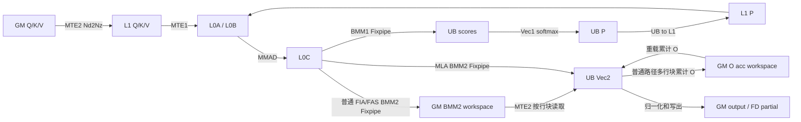

# FIA / FAS 如何在 arch35 上支撑 HeadDim 512

> 范围：DAV_3510 / arch35，FP16/BF16 非量化前向。普通注意力按 QK HeadDim=512、V HeadDim=512、无独立 rope 讨论；FIA MLA 单列 QK=512+64、V=512 的特例。FAS 指训练用前向算子 `flash_attention_score`，本文不覆盖 `flash_attention_score_grad`。
>
> 核验基线：2026-11-05，本机 `ops-transformer` 提交 `75b6beb460eb32644a6c87fa5f9d76b756d17b4d`。本文为 Host tiling、编译分发和 kernel 源码的静态核对，未执行 CANN 编译或 NPU 数值/性能测试。源码链接相对本文，前缀为 `../../ops-transformer/attention/`。

**当前主路径**：普通 FIA GQA D=512 由兜底 tiling 进入共用 infer kernel，Cube S1=128、S2=128，BMM2 写 GM；FAS D=512 同样按 N=128 计算 BMM2、写 GM，再由 Vec2 每次最多处理 16 行。FIA MLA 使用 Cube M=64、S2=128，将 Q/K 的 512+64 维内容放在 L1，复用 KV/P 槽，BMM2 直接写 UB。具体门禁、切块和源码证据见第 1—4 节。

## 0. 维度、缓冲预算与数据通路

### 0.1 统一口径

| 名称 | 本文含义 |
|---|---|
| D / DV | 分别为 QK 归约宽度、V/输出宽度；普通路径均为 512 |
| S1 / M | Cube 的 query 侧 tile 容量；FIA 合轴时可能表示 G×S1，实际有效行数可能小于模板容量 |
| S2 | 每轮处理的 KV 序列 tile 容量，本文主路径为 128 |
| BMM1 / Vec1 | QKᵀ 与 scores 的 softmax；softmax 沿 S2，不沿 D 归约 |
| BMM2 / Vec2 | P·V 与在线输出更新、归一化和写出 |
| cvRatio=2 | 本文涉及的 1 个 AIC 对应 2 个 AIV；Host sOuterFactor 与 Cube M 必须区分 |
| KiB | 1024 字节；FP16/BF16 输入每元素 2 字节，本文 FP32 累加结果每元素 4 字节 |

Host 从平台取得 `aivNum/aicNum`。Fixpipe 双目标按 M 拆分结果，例如 MLA Cube M=64 对应单 AIV 最多处理 32 行；UB 分配也含 `M/CV_RATIO`。[平台 cvRatio](../../ops-transformer/attention/fused_infer_attention_score/op_host/arch35/fia_tiling_nonquant_gqa.cpp#L244)、[MLA 双目标 Fixpipe](../../ops-transformer/attention/fused_infer_attention_score/op_kernel/arch35/fia_block_cube_noquant_mla.h#L338)、[MLA UB 分配](../../ops-transformer/attention/fused_infer_attention_score/op_kernel/arch35/fia_kernel_noquant_mla.h#L158)。

### 0.2 源码中的缓冲预算

| Buffer | 初始化大小 | 证据 |
|---|---|---|
| L1 / TSCM | 524288 字节 = 512 KiB | [MLA L1 初始化](../../ops-transformer/attention/fused_infer_attention_score/op_kernel/arch35/fia_kernel_noquant_mla.h#L158) |
| L0A / L0B | 各 65536 字节 = 64 KiB | [共用 Cube 初始化](../../ops-transformer/attention/flash_attention_score/op_kernel/arch35/flash_attention_noquant_block_cube.h#L440) |
| L0C | 262144 字节 = 256 KiB | [共用 Cube 初始化](../../ops-transformer/attention/flash_attention_score/op_kernel/arch35/flash_attention_noquant_block_cube.h#L443) |
| UB | 容量由平台查询，各路径分别初始化实际使用的数据区 | [Host 查询 UB](../../ops-transformer/attention/fused_infer_attention_score/op_host/arch35/fia_tiling_nonquant_gqa.cpp#L246)、[共用 kernel 分配](../../ops-transformer/attention/flash_attention_score/op_kernel/arch35/flash_attention_noquant_kernel_base.h#L361)、[MLA 分配](../../ops-transformer/attention/fused_infer_attention_score/op_kernel/arch35/fia_kernel_noquant_mla.h#L158) |

本文 FP16/BF16 共用 Cube 的 L0A/L0B 使用 32 KiB 槽；大 D 路径的 L0C 使用 128 KiB 槽的双缓冲。L0C 的逻辑结果大小与 policy 单槽容量分别计算。[L0 policy 初始化](../../ops-transformer/attention/flash_attention_score/op_kernel/arch35/flash_attention_noquant_block_cube.h#L440)。

下图区分 BMM1、普通 BMM2 和 MLA BMM2 的落点。普通路径多行块 Vec2 的累计 O 还会保存/重载 GM；MLA 的 Flash Decode 分核输出可能写 FD partial。[普通 BMM2 Fixpipe](../../ops-transformer/attention/flash_attention_score/op_kernel/arch35/flash_attention_noquant_block_cube.h#L775)、[MLA BMM2 Fixpipe](../../ops-transformer/attention/fused_infer_attention_score/op_kernel/arch35/fia_block_cube_noquant_mla.h#L338)、[累计 O 重载](../../ops-transformer/attention/flash_attention_score/op_kernel/arch35/flash_attention_noquant_block_vec_base.h#L1627)、[MLA 输出分发](../../ops-transformer/attention/fused_infer_attention_score/op_kernel/arch35/fia_block_vec_noquant_mla.h#L488)。



## 1. 普通 FIA / FAS 的共用策略：L1 切 D，BMM2 写 GM

本节限定普通 FP16/BF16 D=DV=512。FIA 兜底使用 `FANoQuantBlockCube` 与 infer Vector；FAS 前向使用同一共用 Cube 实现。FIA MLA 采用单独的重构 Cube，见第 3 节。[FIA Cube/Vector 类型](../../ops-transformer/attention/fused_infer_attention_score/op_kernel/arch35/fia_arch35_noquant.h#L45)、[FIA Aligned512 分发](../../ops-transformer/attention/fused_infer_attention_score/op_kernel/arch35/fia_arch35_noquant.h#L115)、[FAS 调用 Cube](../../ops-transformer/attention/flash_attention_score/op_kernel/arch35/flash_attention_score_kernel_train.h#L296)。

### 1.1 K/V 按 128 宽分片，Q 保留全宽

共用 Cube 在 D 模板大于 256 时令 `isSplitL1=true`；FP16/BF16 的 `l1BaseD=128`。FP32 的分档不同，本文的 128 宽结论不扩展到 FP32。[isSplitL1](../../ops-transformer/attention/flash_attention_score/op_kernel/arch35/flash_attention_noquant_block_cube.h#L162)。

源码摘录：[flash_attention_noquant_block_cube.h:L196-L197](../../ops-transformer/attention/flash_attention_score/op_kernel/arch35/flash_attention_noquant_block_cube.h#L196)

```cpp
    static constexpr uint32_t l1BaseD =
        isFp8 ? 256 : ((IsSameType<INPUT_T, float>::value) ? (dBaseSize > 128 ? 64 : 128) : 128);
```

Q 的 L1 缓冲保留完整 D 模板容量；K/V 按 `S2*l1BaseD*sizeof(INPUT_T)` 分配。Q 首轮按片装入后全宽驻留，供后续 S2 循环复用。

源码摘录：[flash_attention_noquant_block_cube.h:L416-L423](../../ops-transformer/attention/flash_attention_score/op_kernel/arch35/flash_attention_noquant_block_cube.h#L416)

```cpp
            constexpr uint32_t mm1LeftSize = s1BaseSize * dBaseSize * sizeof(INPUT_T);
            /* fp8场景bmm1右矩阵在L1上全载*/
            constexpr uint32_t mm1RightSize =
                isFp8 ? (dBaseSize * s2BaseSize * sizeof(INPUT_T)) : (s2BaseSize * l1BaseD * sizeof(INPUT_T));
            constexpr uint32_t mm2RightSize = s2BaseSize * l1BaseD * sizeof(INPUT_T);
            l1QBuffers.Init((*l1BufferManagerPtr), mm1LeftSize);
            l1KBuffers.Init((*l1BufferManagerPtr), mm1RightSize);
            l1VBuffers.Init((*l1BufferManagerPtr), mm2RightSize);
```

普通 FIA 的 Q 模板为 512，FAS 的模板档为 768；运行时 D 都是 512。模板档位也参与缓冲预留，不能把“运行时不计算 768 列”理解为“所有存储都按 512 分配”。FAS 分档见第 4.1 节。

### 1.2 BMM1：4 轮 K=128，在 L0C 累加

`IterateBmm1()` 在 `isSplitL1` 时进入 `IterateBmm1NdL1SplitK()`。[BMM1 入口](../../ops-transformer/attention/flash_attention_score/op_kernel/arch35/flash_attention_noquant_block_cube.h#L656)。

源码摘录：[flash_attention_noquant_block_cube.h:L1835-L1840](../../ops-transformer/attention/flash_attention_score/op_kernel/arch35/flash_attention_noquant_block_cube.h#L1835)

```cpp
__aicore__ inline void FANoQuantBlockCube<TEMPLATE_ARGS>::IterateBmm1NdL1SplitK(
    Buffer<BufferType::UB, SyncType::CROSS_CORE_SYNC_BOTH>& outputBuf, RunInfo<isInfer>& runInfo,
    ConstInfo<isInfer, hasRope>& constInfo)
{
    constexpr uint32_t baseK = l1BaseD;
    uint32_t kLoops = (constInfo.dSize + baseK - 1) / baseK; // 尾块处理
```

D=512 时 `kLoops=4`。首个 S2 循环按 D 偏移 0/128/256/384 搬入 Q，之后通过 `GetPre()` 复用；K 每轮加载对应 D 切片。结果累加在同一个 BMM1 L0C 结果中，4 轮完成后再 Fixpipe 到 UB、执行 Vec1 softmax，不对各个 D 切片分别做 softmax。[首轮 Query 搬运及后续复用](../../ops-transformer/attention/flash_attention_score/op_kernel/arch35/flash_attention_noquant_block_cube.h#L1886)、[Key 切片搬运](../../ops-transformer/attention/flash_attention_score/op_kernel/arch35/flash_attention_noquant_block_cube.h#L1923)、[BMM1 完整实现](../../ops-transformer/attention/flash_attention_score/op_kernel/arch35/flash_attention_noquant_block_cube.h#L1835)、[FIA 调用顺序](../../ops-transformer/attention/fused_infer_attention_score/op_kernel/arch35/flash_attention_noquant_kernel_infer.h#L119)、[FAS 调用顺序](../../ops-transformer/attention/flash_attention_score/op_kernel/arch35/flash_attention_score_kernel_train.h#L296)。

### 1.3 BMM2：4 轮 N=128，每轮结果写入 GM 对应列

共用 Cube 对 D/DV 模板大于 256 的场景调用 `IterateBmm2L1SplitN()`。[BMM2 入口](../../ops-transformer/attention/flash_attention_score/op_kernel/arch35/flash_attention_noquant_block_cube.h#L827)。

源码摘录：[flash_attention_noquant_block_cube.h:L687-L702](../../ops-transformer/attention/flash_attention_score/op_kernel/arch35/flash_attention_noquant_block_cube.h#L687)

```cpp
    // dVTemplateType > 256, L1切N, 左矩阵不变，右矩阵每次循环搬运S2 * 128
    if constexpr (bmm2Write2Ub) {
        outputBuf.WaitCrossCore();
    }
    constexpr uint32_t baseN = l1BaseD;
    uint32_t nLoops = ((uint32_t)constInfo.dSizeV + baseN - 1) / baseN; // 尾块处理
    uint32_t realN = baseN;
    for (uint32_t n = 0; n < nLoops; ++n) {
        if (n == nLoops - 1) {
            uint32_t tailSize = (uint32_t)constInfo.dSizeV % baseN;
            realN = tailSize ? tailSize : baseN;
        }
        Buffer<BufferType::L1> mm2B = l1VBuffers.Get();
        mm2B.Wait<HardEvent::MTE1_MTE2>(); // 占用L1B
        LocalTensor<INPUT_T> mm2BTensor = mm2B.GetTensor<INPUT_T>();
        uint64_t gmNOffset = n * baseN;
```

DV=512、`baseN=128`，共 4 轮；每轮把 V 的 `S2×128` 切片搬入 L1，与相同的 P 相乘，再 Fixpipe 到 GM 的 `n*baseN` 列偏移。[MatmulFull](../../ops-transformer/attention/flash_attention_score/op_kernel/arch35/flash_attention_noquant_block_cube.h#L754)、[Fixpipe 目的偏移](../../ops-transformer/attention/flash_attention_score/op_kernel/arch35/flash_attention_noquant_block_cube.h#L803)。

```text
每轮完整 tile 的 L0C 逻辑结果：128×128×4 = 64 KiB
完整输出的理论体积：          128×512×4 = 256 KiB
源码 L0C policy 单槽容量：                 128 KiB，双缓冲
```

该实现不同时在 L0C 保留完整 128×512 输出。因此不能用完整输出的体积解释“占满 L0C 才必须写 GM”；落点的直接代码依据是 `GetC2Position()` 的模板策略，见第 2.3 节。[L0C 分配](../../ops-transformer/attention/flash_attention_score/op_kernel/arch35/flash_attention_noquant_block_cube.h#L453)。

## 2. 普通 FIA GQA D=512：当前实际走兜底 infer kernel

### 2.1 重构 GQA 的 Host 门禁拒绝普通 D=512

`FiaTilingNonQuantArch35::IsCapableSparseLayoutCheckGqa()` 包含：

源码摘录：[fia_tiling_nonquant_gqa.cpp:L154-L156](../../ops-transformer/attention/fused_infer_attention_score/op_host/arch35/fia_tiling_nonquant_gqa.cpp#L154)

```cpp
    if (fiaInfo_->qkHeadDim != 128 && fiaInfo_->mlaMode != MlaMode::ROPE_COMBINE_D128) { // 非D=128 GQA，且非Prefill MLA
        return false;
    }
```

普通 GQA 的 `mlaMode=NO_MLA`、`qkHeadDim=512` 会被拒绝。Config 表或 kernel 中存在 D=512 的分支，不表示 Host 当前能选中它。

`FiaTilingBase::DoTiling()` 先检查 `IsCapable()`；失败返回 `GRAPH_PARAM_INVALID`，注册器继续尝试后续 tiling。`FusedInferAttentionScoreTilingImpl` 以优先级 999 注册为兜底。[能力检查先于 DoOpTiling](../../ops-transformer/attention/common/op_host/fia_tiling_base.h#L58)、[注册器继续尝试](../../ops-transformer/attention/common/op_host/fia_tiling_templates_registry.h#L110)、[兜底注册](../../ops-transformer/attention/fused_infer_attention_score/op_host/arch35/fused_infer_attention_score_tiling_impl.cpp#L2164)。

输入通过公共检查、兜底 tiling 成功时，实际路径为：

```text
FiaTilingNonQuantArch35::IsCapable() 返回 false
  → FusedInferAttentionScoreTilingImpl
  → isReconstructTemp=false，D/DV 模板为 512/512
  → fia_noquant_regbase 的 Aligned512 分支
  → FlashAttentionNoQuantKernelInfer
     + FANoQuantBlockCube
     + FANoQuantBlockVecInfer
```

[设置 isReconstructTemp=false](../../ops-transformer/attention/fused_infer_attention_score/op_host/arch35/fused_infer_attention_score_tiling_impl.cpp#L1484)、[FP16 分发](../../ops-transformer/attention/fused_infer_attention_score/op_kernel/arch35/fia_arch35_noquant.h#L100)、[BF16 分发](../../ops-transformer/attention/fused_infer_attention_score/op_kernel/arch35/fia_arch35_noquant.h#L156)。

### 2.2 Host sOuterFactor=64，对应 Cube S1=128

兜底 Host 默认 `sOuterFactor_=64`、`sInnerFactor_=128`，生成 Config 前将前者乘 `platformInfo_.cvRatio`。本文 `cvRatio=2`，所以：

```text
Host sOuterFactor = 64
Cube S1/M         = 64×2 = 128
Cube S2           = 128
Config            = S1Aligned128_S2Aligned128_DAligned512_DVAligned512
```

[默认切块](../../ops-transformer/attention/fused_infer_attention_score/op_host/arch35/fused_infer_attention_score_tiling_impl.cpp#L361)、[乘 cvRatio](../../ops-transformer/attention/fused_infer_attention_score/op_host/arch35/fused_infer_attention_score_tiling_impl.cpp#L1329)、[对应 Config](../../ops-transformer/attention/fused_infer_attention_score/op_host/arch35/fused_infer_attention_score_tiling_impl.cpp#L1363)。FIA 合轴时 M 可对应 G×S1；模板容量 128 不表示每次恰好有 128 个有效 query token。[合轴 Query 坐标](../../ops-transformer/attention/flash_attention_score/op_kernel/arch35/flash_attention_noquant_block_cube.h#L1891)。

### 2.3 DAV_3510 的 BMM2 落点：GetC2Position → GM

共用 Cube 的 DAV_3510 分支调用 `GetC2Position()`；`GetC2PositionForTrain()` 位于对应的 `#else`，不作为本文 arch35 的实际落点函数。

源码摘录：[flash_attention_noquant_block_cube.h:L181-L197](../../ops-transformer/attention/flash_attention_score/op_kernel/arch35/flash_attention_noquant_block_cube.h#L181)

```cpp
#if __NPU_ARCH__ == 3510
    static constexpr TPosition bmm2OutPos =
        GetC2Position(dVTemplateType,
                      UbOutCondition<INPUT_T>(IsSameType<INPUT_T, float>::value, pseMode, hasAtten, hasDrop, hasRope,
                                              s1BaseSize == 64),
                      (s2BaseSize == 256 && s1BaseSize == 64), isMlaFullQuant, false, optionalDn);
#else
    static constexpr TPosition bmm2OutPos =
        GetC2PositionForTrain(dVTemplateType,
                              UbOutConditionForTrain<INPUT_T>(IsSameType<INPUT_T, float>::value, pseMode, hasAtten,
                                                              hasDrop, hasRope, s1BaseSize == 32 * CV_RATIO),
                              (s2BaseSize == 256 && s1BaseSize == 32 * CV_RATIO), isMlaFullQuant);
#endif
    static constexpr bool bmm2Write2Ub = bmm2OutPos == TPosition::VECCALC;
    static constexpr FixpipeConfig BMM2_FIXPIPE_CONFIG = {CO2Layout::ROW_MAJOR, bmm2Write2Ub};
    static constexpr uint32_t l1BaseD =
        isFp8 ? 256 : ((IsSameType<INPUT_T, float>::value) ? (dBaseSize > 128 ? 64 : 128) : 128);
```

普通 FIA GQA 的 DV 模板为 512、S1/S2 为 128/128，且不属于 MLA 量化或可选 DN 特例，不满足 `GetC2Position()` 的 UB 条件，因此返回 GM、`bmm2Write2Ub=false`。[GetC2Position 条件](../../ops-transformer/attention/common/op_kernel/arch35/flash_attention_score_common_regbase_arch35.h#L228)。

BMM2 按 N=128 分块写 GM，infer Vector 继承共用 `FANoQuantBlockVecBase`，从 GM 读取处理。[infer Vector 继承](../../ops-transformer/attention/fused_infer_attention_score/op_kernel/arch35/flash_attention_noquant_block_vec_infer.h#L29)。

### 2.4 Vec2 每次最多 16 行，累计 O 可能经过 GM

共用 Vec2 按以下条件分发：

源码摘录：[flash_attention_noquant_block_vec_base.h:L1732-L1738](../../ops-transformer/attention/flash_attention_score/op_kernel/arch35/flash_attention_noquant_block_vec_base.h#L1732)

```cpp
    bmm2ResBuf.WaitCrossCore();

    if constexpr (bmm2Write2Ub) {
        ProcessVec2OnUb(bmm2ResBuf, runInfo, constInfo);
    } else if constexpr (splitD) {
        GlobalTensor<T> mmRes = bmm2ResBuf.template GetTensor<T>();
        ProcessVec2DSplit(mmRes, runInfo, constInfo);
```

运行时 `constInfo.dBasicBlock=Align64(dSizeV)`；DV=512 时：

```text
vec2S1BaseSize = 8192/512 = 16 行/AIV
单个 FP32 数据块 = 16×512×4 = 32 KiB
```

[运行时 DV 对齐](../../ops-transformer/attention/flash_attention_score/op_kernel/arch35/flash_attention_noquant_kernel_base.h#L477)、[Vec2 行块计算](../../ops-transformer/attention/flash_attention_score/op_kernel/arch35/flash_attention_noquant_block_vec_base.h#L1570)。每个行块保留完整 DV=512；函数名虽为 `ProcessVec2DSplit`，这里实际沿行数分块。完整 Cube M=128 在双 AIV 下，每个 AIV 最多处理 64 行，再按最多 16 行循环，尾块按实际行数处理。[循环和实际行数](../../ops-transformer/attention/flash_attention_score/op_kernel/arch35/flash_attention_noquant_block_vec_base.h#L1574)。

当一个 AIV 需要多个行块时，非末 S2 轮的累计 O 写入 `vec2ResGm`，后续重载；最后一轮归一化、写出最终结果。[重载累计 O](../../ops-transformer/attention/flash_attention_score/op_kernel/arch35/flash_attention_noquant_block_vec_base.h#L1627)、[最终输出和非末轮保存](../../ops-transformer/attention/flash_attention_score/op_kernel/arch35/flash_attention_noquant_block_vec_base.h#L1700)。

### 2.5 当前 infer 流水与重构代码边界

`FlashAttentionNoQuantKernelInfer::ProcessS2Loop()` 稳态采用四阶段偏斜；启动/排空由 `taskId` 和 `notLast*` 控制。[infer 流水](../../ops-transformer/attention/fused_infer_attention_score/op_kernel/arch35/flash_attention_noquant_kernel_infer.h#L114)。

| 本轮阶段 | 所属任务 | 动作 |
|---|---|---|
| AIC BMM1 | t | scores Fixpipe 到 UB |
| AIV Vec1 | t−1 | softmax，P 写 L1 |
| AIC BMM2 | t−2 | 普通 D=512 写 GM |
| AIV Vec2 | t−3 | GM→UB，在线更新及写回 |

共用基类按三份 GM BMM2 buffer 管理 workspace，`splitD` 时还计入累计 O 数据区。[GM 分配](../../ops-transformer/attention/flash_attention_score/op_kernel/arch35/flash_attention_noquant_kernel_base.h#L278)。

重构 GQA 类自身的 `BMM2_FIXPIPE_CONFIG` 写 UB，Vec2 在 UB 处理完整 DV，`PRELOAD_N=3` 执行器的 C2/Vec2 落后两个任务。这些事实只描述该类，**不表示普通 D=512 当前能由 Host 进入它**。[重构 Fixpipe](../../ops-transformer/attention/fused_infer_attention_score/op_kernel/arch35/fia_block_cube_noquant_gqa.h#L77)、[重构 Vec2](../../ops-transformer/attention/fused_infer_attention_score/op_kernel/arch35/fia_block_vec_noquant_gqa.h#L411)、[重构执行器](../../ops-transformer/attention/fused_infer_attention_score/op_kernel/arch35/fia_kernel_noquant_gqa.h#L522)。

该类 D>256 时虽然为 V 分配 `S2×128` 缓冲，但 `IterateBmm2()` 实际调用 `IterateBmm2l0Split()`，其中 `CopyValueTile()` 传入完整 DV；另一个 `IterateBmm2L1SplitN()` 没有从该入口调用。不能只依据分配注释或 `MatmulN` 名称，宣称该类已实现 D=512 的 GM→L1 V 分片。[V 分配](../../ops-transformer/attention/fused_infer_attention_score/op_kernel/arch35/fia_block_cube_noquant_gqa.h#L155)、[完整 DV 拷贝](../../ops-transformer/attention/fused_infer_attention_score/op_kernel/arch35/fia_block_cube_noquant_gqa.h#L340)、[实际入口](../../ops-transformer/attention/fused_infer_attention_score/op_kernel/arch35/fia_block_cube_noquant_gqa.h#L494)、[CopyValueTile 调用](../../ops-transformer/attention/fused_infer_attention_score/op_kernel/arch35/fia_block_cube_noquant_gqa.h#L554)。

## 3. FIA MLA 重构：QK=576、DV=512，KV/P 共享 L1

### 3.1 维度与完整 Host 门禁

512+64+512 是维度条件。进入 `FiaTilingNonQuantMlaArch35` 还须满足下表的能力检查，并通过公共输入检查及后续 tiling。

| 门禁 | 当前检查 | 证据 |
|---|---|---|
| 基础场景 | 非空、NO_QUANT、mlaMode=ROPE_SPLIT_D512 | [基本检查](../../ops-transformer/attention/fused_infer_attention_score/op_host/arch35/fia_tiling_nonquant_mla.cpp#L50) |
| 维度 | qkHeadDim=512、ropeHeadDim=64、vHeadDim=512 | [维度条件](../../ops-transformer/attention/fused_infer_attention_score/op_host/arch35/fia_tiling_nonquant_mla.cpp#L95) |
| head 数 | N2=1，N1∈[1,128] | [head 数条件](../../ops-transformer/attention/fused_infer_attention_score/op_host/arch35/fia_tiling_nonquant_mla.cpp#L100) |
| sparse/mask | sparse mode 为 0/3/4；mode=0 时不能传 mask | [稀疏条件](../../ops-transformer/attention/fused_infer_attention_score/op_host/arch35/fia_tiling_nonquant_mla.cpp#L86) |
| 排除特性 | 公共前缀、PSE/alibi、Q/KV 左 padding、后量化、sink、isQKVDDifferent、tensorlist | [特性检查](../../ops-transformer/attention/fused_infer_attention_score/op_host/arch35/fia_tiling_nonquant_mla.cpp#L70) |

该能力检查没有要求 `s1Size==1`，不能仅由“Decode MLA”名称推导只支持单 token。该类固定设置 MLA Config、`hasRope=true`、`isReconstructTemp=true`，分发到重构 MLA kernel。[唯一 Config](../../ops-transformer/attention/fused_infer_attention_score/op_host/arch35/fia_tiling_nonquant_mla.cpp#L458)、[hasRope](../../ops-transformer/attention/fused_infer_attention_score/op_host/arch35/fia_tiling_nonquant_mla.cpp#L487)、[重构标志](../../ops-transformer/attention/fused_infer_attention_score/op_host/arch35/fia_tiling_nonquant_mla.cpp#L492)、[MLA 分发](../../ops-transformer/attention/fused_infer_attention_score/op_kernel/arch35/fia_arch35_noquant.h#L88)。

### 3.2 Host 32，Cube M=64，S2=128

Host `sOuterFactor_=32`、`sInnerFactor_=128`，Cube M 为 `32×CV_RATIO=64`。[Host 切块](../../ops-transformer/attention/fused_infer_attention_score/op_host/arch35/fia_tiling_nonquant_mla.cpp#L263)、[Host mBaseSize](../../ops-transformer/attention/fused_infer_attention_score/op_host/arch35/fia_tiling_nonquant_mla.cpp#L312)。

源码摘录：[fia_block_cube_noquant_mla.h:L101-L104](../../ops-transformer/attention/fused_infer_attention_score/op_kernel/arch35/fia_block_cube_noquant_mla.h#L101)

```cpp
    __aicore__ inline void InitBuffers()
    {
        static_assert(mBaseSize == 64 && s2BaseSize == 128, "mBaseSize != 64 or s2BaseSize != 128");
        l1QBuffers.Init(*l1BufferManagerPtr, (uint32_t)mBaseSize * 576 * sizeof(Q_T));
```

### 3.3 L1 预算：Q 72 KiB + 共享槽 432 KiB = 504 KiB

源码摘录：[fia_kernel_noquant_mla.h:L160-L165](../../ops-transformer/attention/fused_infer_attention_score/op_kernel/arch35/fia_kernel_noquant_mla.h#L160)

```cpp
        uint32_t mm1ResultSize = mBaseSize / CV_RATIO * s2BaseSize * sizeof(T);
        constexpr uint32_t mm2ResultSize = mBaseSize / CV_RATIO * dVBaseSize * sizeof(T);
        uint32_t mm12RightSize = s2BaseSize * 576 * sizeof(INPUT_T);
        l1BufferManager_.Init(pipe_, 524288); // 512 * 1024
        // 3Buffer
        l1KvPBuffers_.Init(l1BufferManager_, mm12RightSize); // L1: 144k * 3 = 432k
```

按 FP16/BF16 每元素 2 字节、源码数据区分配计算：

| L1 数据区 | 字节公式 | 容量 |
|---|---|---|
| 完整 Q+Q_rope | 64×576×2 | 72 KiB |
| 单个 KV/P 共享槽 | 128×576×2 | 144 KiB |
| 3 个共享槽 | 128×576×2×3 | 432 KiB |
| 合计 | 72+432 | **504 KiB** |
| 与 512 KiB 数据区之差 | 512−504 | 8 KiB |

每个共享槽的生命周期如下；偏移以 INPUT_T 元素计：

```text
槽起点                         +128×512 元素                 槽末尾
|--------- 128 KiB -----------|---------- 16 KiB ------------|
BMM1: K（512 维共享 KV）       K_rope（128×64）
BMM2: V（复用前段共享 KV）     P（64×128，覆盖 rope 区）
```

此路径在 L1 保留全宽 576 的 KV；P 复用 BMM1 结束后的 rope 区。[K 与 K_rope 写入](../../ops-transformer/attention/fused_infer_attention_score/op_kernel/arch35/fia_block_cube_noquant_mla.h#L245)、[P 写入尾部](../../ops-transformer/attention/fused_infer_attention_score/op_kernel/arch35/fia_block_vec_noquant_mla.h#L408)、[BMM2 读取](../../ops-transformer/attention/fused_infer_attention_score/op_kernel/arch35/fia_block_cube_noquant_mla.h#L354)。

### 3.4 一次 MatmulK 调用，内部仍有 5 轮 MMAD

Q+Q_rope、K+K_rope 已在 L1 拼接，归约宽度 `dSize+dSizeRope=576`，一次调用 `MatmulK<...,128,...>` 得到合并后的 scores。[Query 与 rope 装入](../../ops-transformer/attention/fused_infer_attention_score/op_kernel/arch35/fia_block_cube_noquant_mla.h#L293)。

源码摘录：[fia_block_cube_noquant_mla.h:L318-L323](../../ops-transformer/attention/fused_infer_attention_score/op_kernel/arch35/fia_block_cube_noquant_mla.h#L318)

```cpp
            MMParam mmParam = MakeMMParam((uint32_t)runInfo.actMSize, (uint32_t)runInfo.actSingleLoopS2Size,
                                          (uint32_t)(constInfo.dSize + constInfo.dSizeRope), false, true);

            MatmulK<Q_T, KV_T, T, mBaseSize, s2BaseSize, 128, ABLayout::MK, ABLayout::KN>(
                mm1A.GetTensor<Q_T>(), kvpSharedBuf.GetTensor<KV_T>(), mmL0ABuffers, mmL0BBuffers,
                mm1ResL0C.GetTensor<T>(), mmParam);
```

`MatmulK` 内部仍按 K=128 加载到 L0、执行 MMAD：`ceil(576/128)=5` 轮，宽度为 128/128/128/128/64。合并的是无 rope 与 rope 部分的 QK 计算入口；没有取消 L1→L0 分块。[内部 K 循环](../../ops-transformer/attention/common/op_kernel/matmul.h#L684)、[内部 MMAD](../../ops-transformer/attention/common/op_kernel/matmul.h#L751)。

### 3.5 BMM2：左矩阵 P 在尾部，右矩阵 V 在槽起点

源码摘录：[fia_block_cube_noquant_mla.h:L359-L368](../../ops-transformer/attention/fused_infer_attention_score/op_kernel/arch35/fia_block_cube_noquant_mla.h#L359)

```cpp
            uint64_t VDsize = (uint32_t)dVTemplateType;
            Buffer<BufferType::L0C> mm2ResL0C = mmL0CBuffers.Get();
            mm2ResL0C.Wait<HardEvent::FIX_M>(); // 占用
            MMParam param =
                MakeMMParam((uint32_t)mBaseSize, (uint32_t)constInfo.dSizeV, (uint32_t)runInfo.actSingleLoopS2Size,
                            false, false, true, true, 0, (uint32_t)runInfo.actMSize);

            MatmulN<Q_T, KV_T, T, mBaseSize, 128, s2BaseSize, ABLayout::MK, ABLayout::KN>(
                kvpSharedBuf.GetTensor<INPUT_T>(s2BaseSize * VDsize), kvpSharedBuf.GetTensor<INPUT_T>(), mmL0ABuffers,
                mmL0BBuffers, mm2ResL0C.GetTensor<T>(), param);
```

第一个参数 `kvpSharedBuf.GetTensor<INPUT_T>(s2BaseSize*VDsize)` 指向 **P**，是左矩阵；第二个无偏移参数指向 **V**，是右矩阵。Vector 向同一 `s2BaseSize*dVBaseSize` 偏移写 P。[Vector 写 P 的偏移](../../ops-transformer/attention/fused_infer_attention_score/op_kernel/arch35/fia_block_vec_noquant_mla.h#L408)。

`MatmulN` 按 N=128 分块，在 L0C 保留完整 64×512 的本轮结果，再 Fixpipe 写 UB。该结果为 `64×512×4=128 KiB`，与 L0C 单槽匹配。Fixpipe 按 M 分给两个 AIV，单 AIV 结果最多 `32×512×4=64 KiB`，BMM2 UB 使用双缓冲。[L0C 槽](../../ops-transformer/attention/fused_infer_attention_score/op_kernel/arch35/fia_block_cube_noquant_mla.h#L113)、[双目标 Fixpipe](../../ops-transformer/attention/fused_infer_attention_score/op_kernel/arch35/fia_block_cube_noquant_mla.h#L338)、[UB 按 M/CV_RATIO 分配](../../ops-transformer/attention/fused_infer_attention_score/op_kernel/arch35/fia_kernel_noquant_mla.h#L158)。

Vec2 在 UB 以完整 DV=512 做在线 O 更新，不进入共用路径的 16 行循环。启用 Flash Decode 且跨 S2 分核时，还会写 FD partial/workspace 供归并；“BMM2 写 UB”描述的是 Cube 结果落点。[MLA Vec2](../../ops-transformer/attention/fused_infer_attention_score/op_kernel/arch35/fia_block_vec_noquant_mla.h#L439)、[最终输出或 FD partial](../../ops-transformer/attention/fused_infer_attention_score/op_kernel/arch35/fia_block_vec_noquant_mla.h#L488)。

### 3.6 PRELOAD_N=2 与三槽复用

MLA 的 `PRELOAD_N=2`，当前任务做 C1/Vec1、落后一个任务做 C2/Vec2；KV/P 数据区本身使用三缓冲。阶段偏移与共享槽数量应分别理解。[PRELOAD_N 常量](../../ops-transformer/attention/fused_infer_attention_score/op_kernel/arch35/fia_kernel_noquant_mla.h#L44)、[共享槽分配](../../ops-transformer/attention/fused_infer_attention_score/op_kernel/arch35/fia_kernel_noquant_mla.h#L158)、[ExecuteTask](../../ops-transformer/attention/fused_infer_attention_score/op_kernel/arch35/fia_kernel_noquant_mla.h#L493)。

## 4. FAS 前向：768 模板档，BMM2 写 GM，Vec2 按行处理

### 4.1 编译模板 768，实际 D/DV 仍为 512

FAS 基本 tiling 先按实际 D 对齐，大于 256 时选择 `ALIGNED_768`。

源码摘录：[flash_attention_score_tiling_basic.cpp:L53-L61](../../ops-transformer/attention/flash_attention_score/op_host/arch35/flash_attention_score_tiling_basic.cpp#L53)

```cpp
    void CalcDBasicBlock() override
    {
        /* 先确定D的基本块，确定的逻辑是按照64来分档 */
        dBasicBlock = AlignUp(dSize + dSizeRope, D_TEMPLATE_SPLIT_SIZE);
        /* dBasicBlock > 256 直接令D轴大小为768 */
        if (dBasicBlock > NUM_256) {
            dTemplateType = DTemplateType::ALIGNED_768;
            return; // 直接返回不往下走
        }
```

`CalcDVBasicBlock()` 在本文场景令 DV 模板与 D 模板相同，故 D/DV 均为 768 档；运行时仍携带实际 512。FP16/BF16、D>256 的 S1/S2 模板均为 128；FP32 在该分支的 S1 为 64，属于本文之外的分档。[DV 模板分档](../../ops-transformer/attention/flash_attention_score/op_host/arch35/flash_attention_score_tiling_regbase.cpp#L2006)、[S1/S2 分档](../../ops-transformer/attention/flash_attention_score/op_host/arch35/flash_attention_score_tiling_basic.cpp#L102)。

模板参与 L1 和 GM 缓冲预留、GM 行跨度；实际 matmul 的 K/N 使用运行时 512。`splitD` 时本场景 GM 行跨度为 768，而 Vec2 只处理实际 DV 对齐后的 512，并跳读行间空隙。[L1 预留](../../ops-transformer/attention/flash_attention_score/op_kernel/arch35/flash_attention_noquant_block_cube.h#L416)、[GM 槽预留](../../ops-transformer/attention/flash_attention_score/op_kernel/arch35/flash_attention_noquant_kernel_base.h#L278)、[Fixpipe 行跨度](../../ops-transformer/attention/flash_attention_score/op_kernel/arch35/flash_attention_noquant_block_cube.h#L803)、[Vec2 跳读](../../ops-transformer/attention/flash_attention_score/op_kernel/arch35/flash_attention_noquant_block_vec_base.h#L1608)。

### 4.2 arch35 落点与 L0C 实际计算

FAS 在 DAV_3510 同样经 `GetC2Position()` 判定，DV 模板 768 返回 GM、`bmm2Write2Ub=false`。`splitD` 由 DV 模板大于 256 决定，BMM2 走第 1.3 节的 `IterateBmm2L1SplitN()`，每轮 N=128、逐列块写 GM。[实际落点分支](../../ops-transformer/attention/flash_attention_score/op_kernel/arch35/flash_attention_noquant_block_cube.h#L181)、[splitD](../../ops-transformer/attention/flash_attention_score/op_kernel/arch35/flash_attention_noquant_block_cube.h#L167)、[BMM2 分发](../../ops-transformer/attention/flash_attention_score/op_kernel/arch35/flash_attention_noquant_block_cube.h#L827)。

完整 tile 的每轮 L0C 逻辑结果为 128×128 FP32，即 64 KiB；L0C policy 是 128 KiB 单槽的双缓冲。“完整输出为 256 KiB”不等于实际同时占满 L0C。[单轮 matmul](../../ops-transformer/attention/flash_attention_score/op_kernel/arch35/flash_attention_noquant_block_cube.h#L754)、[L0C policy](../../ops-transformer/attention/flash_attention_score/op_kernel/arch35/flash_attention_noquant_block_cube.h#L453)。

### 4.3 Vec2 每次最多 16 行，累计 O 可能保存到 GM

FAS 同样从 `bmm2Write2Ub=false && splitD=true` 进入 `ProcessVec2DSplit()`。运行时 `constInfo.dBasicBlock=Align64(dSizeV)=512`，所以按 `8192/512=16` 行/AIV 分块，不用编译模板 768 计算行数。[Vec2 分发](../../ops-transformer/attention/flash_attention_score/op_kernel/arch35/flash_attention_noquant_block_vec_base.h#L1728)、[运行时 dBasicBlock](../../ops-transformer/attention/flash_attention_score/op_kernel/arch35/flash_attention_noquant_kernel_base.h#L477)。

源码摘录：[flash_attention_noquant_block_vec_base.h:L1570-L1578](../../ops-transformer/attention/flash_attention_score/op_kernel/arch35/flash_attention_noquant_block_vec_base.h#L1570)

```cpp
__aicore__ inline void FANoQuantBlockVecBase<TEMPLATE_BASE_ARGS>::ProcessVec2DSplit(
    GlobalTensor<T>& mmRes, RunInfo<isInfer>& runInfo, ConstInfo<isInfer, hasRope>& constInfo)
{
    // bmm2 result is on GM and global update data on UB
    runInfo.vec2S1BaseSize = 8192 / constInfo.dBasicBlock;
    int64_t vec2LoopLimit = CeilDiv(runInfo.halfS1RealSize, runInfo.vec2S1BaseSize);
    LocalTensor<T> vec2ResUb = this->stage2OutBuf.template Get<T>();
    WaitFlag<HardEvent::MTE3_V>(mte3ToVId[0]);
    LocalTensor<T> bmm2Ub = mm2InBuf.template Get<T>();
```

每个 BMM2 输入块为 32 KiB FP32，累计 O 按相同行块更新。多个行块时，累计 O 经 `vec2ResGm` 保存/重载；末轮 S2 归一化、写出最终结果。16 行是处理上限，尾块可能更少。[实际行数](../../ops-transformer/attention/flash_attention_score/op_kernel/arch35/flash_attention_noquant_block_vec_base.h#L1587)、[累计 O 重载](../../ops-transformer/attention/flash_attention_score/op_kernel/arch35/flash_attention_noquant_block_vec_base.h#L1627)、[累计 O 写回及输出](../../ops-transformer/attention/flash_attention_score/op_kernel/arch35/flash_attention_noquant_block_vec_base.h#L1700)。

### 4.4 四阶段偏斜与 GM 三缓冲

FAS 前向稳态按 BMM1、Vec1、BMM2、Vec2 四阶段推进，对应任务 t、t−1、t−2、t−3。`bmm2Write2Ub=false` 时 BMM2 和 Vec2 使用 `bmm2ResGmBuffers`。[FAS 前向流水](../../ops-transformer/attention/flash_attention_score/op_kernel/arch35/flash_attention_score_kernel_train.h#L296)。

GM BMM2 buffer 按三份管理，`splitD` 时另有累计 O 数据区；四阶段任务偏移、三份 workspace 和 L0C 双缓冲是不同概念。[GM 分配](../../ops-transformer/attention/flash_attention_score/op_kernel/arch35/flash_attention_noquant_kernel_base.h#L278)、[L0C 分配](../../ops-transformer/attention/flash_attention_score/op_kernel/arch35/flash_attention_noquant_block_cube.h#L453)。

## 5. 按当前实际路径对照

各列均以通过各自公共输入检查、Host 门禁和 tiling 为前提。S1/M 是 Cube 模板容量；逐项证据见第 1—4 节。

| 项目 | FIA 普通 GQA D=512 | FIA MLA 重构 | FAS 前向 D=512 |
|---|---|---|---|
| Host / 分发 | 兜底，isReconstructTemp=false | MLA 特化，isReconstructTemp=true | 基本 tiling、train 前向 kernel |
| Cube M / S2 | 128 / 128 | 64 / 128 | 128 / 128 |
| Host sOuterFactor | 64，再乘 cvRatio=2 | 32，再乘 cvRatio=2 | 按 S1 模板 128 描述 |
| QK / DV 编译模板 | 512 / 512 | 576 / 512 | 768 / 768 |
| 实际 QK / DV | 512 / 512 | (512+64) / 512 | 512 / 512 |
| Q 的 L1 数据 | 完整 D，首 S2 装入后复用 | 完整 576，首 S2 装入后复用 | 完整实际 D，模板预留 768 |
| K/V 的 L1 策略 | 128 宽分片 | 576 宽 KV/P 共享槽，尾部复用 | 128 宽分片 |
| BMM1 | 4 轮 L1 K=128 | 一次 MatmulK 调用，内部 5 轮 L0 K 分块 | 4 轮 L1 K=128 |
| BMM2 | L1SplitN，4 轮 N=128 | MatmulN，N=128 | L1SplitN，4 轮 N=128 |
| BMM2 落点 | **GM** | **UB** | **GM** |
| 每轮 BMM2 的 L0C 逻辑结果，满 M | 128×128 FP32 = 64 KiB | 64×512 FP32 = 128 KiB | 128×128 FP32 = 64 KiB |
| Vec2 | DSplit，每次最多 16 行/AIV | 单 AIV 最多 32 行、完整 DV 的 UB 更新 | DSplit，每次最多 16 行/AIV |
| 流水 | 四阶段偏斜 | PRELOAD_N=2，KV/P 三槽 | 四阶段偏斜 |

## 6. 关键源码速查

| 角色 | 点击跳转 |
|---|---|
| FIA 能力检查与注册框架 | [fia_tiling_base.h](../../ops-transformer/attention/common/op_host/fia_tiling_base.h#L58)、[fia_tiling_templates_registry.h](../../ops-transformer/attention/common/op_host/fia_tiling_templates_registry.h#L94) |
| FIA GQA 重构门禁 | [fia_tiling_nonquant_gqa.cpp](../../ops-transformer/attention/fused_infer_attention_score/op_host/arch35/fia_tiling_nonquant_gqa.cpp#L141) |
| FIA 实际兜底 tiling | [fused_infer_attention_score_tiling_impl.cpp](../../ops-transformer/attention/fused_infer_attention_score/op_host/arch35/fused_infer_attention_score_tiling_impl.cpp#L361) |
| FIA 模板分发 | [fia_arch35_noquant.h](../../ops-transformer/attention/fused_infer_attention_score/op_kernel/arch35/fia_arch35_noquant.h#L67) |
| FIA 兜底 infer 流水及 Vector | [flash_attention_noquant_kernel_infer.h](../../ops-transformer/attention/fused_infer_attention_score/op_kernel/arch35/flash_attention_noquant_kernel_infer.h#L114)、[flash_attention_noquant_block_vec_infer.h](../../ops-transformer/attention/fused_infer_attention_score/op_kernel/arch35/flash_attention_noquant_block_vec_infer.h#L29) |
| FIA MLA tiling | [fia_tiling_nonquant_mla.cpp](../../ops-transformer/attention/fused_infer_attention_score/op_host/arch35/fia_tiling_nonquant_mla.cpp#L50) |
| FIA MLA Cube / Vector | [fia_block_cube_noquant_mla.h](../../ops-transformer/attention/fused_infer_attention_score/op_kernel/arch35/fia_block_cube_noquant_mla.h#L101)、[fia_block_vec_noquant_mla.h](../../ops-transformer/attention/fused_infer_attention_score/op_kernel/arch35/fia_block_vec_noquant_mla.h#L408) |
| FIA MLA kernel | [fia_kernel_noquant_mla.h](../../ops-transformer/attention/fused_infer_attention_score/op_kernel/arch35/fia_kernel_noquant_mla.h#L158) |
| FAS D/S1/S2 分档 | [flash_attention_score_tiling_basic.cpp](../../ops-transformer/attention/flash_attention_score/op_host/arch35/flash_attention_score_tiling_basic.cpp#L53) |
| FAS DV 模板分档 | [flash_attention_score_tiling_regbase.cpp](../../ops-transformer/attention/flash_attention_score/op_host/arch35/flash_attention_score_tiling_regbase.cpp#L2006) |
| 共用 BMM2 落点 | [flash_attention_score_common_regbase_arch35.h](../../ops-transformer/attention/common/op_kernel/arch35/flash_attention_score_common_regbase_arch35.h#L228) |
| 共用 Cube / Vec2 | [flash_attention_noquant_block_cube.h](../../ops-transformer/attention/flash_attention_score/op_kernel/arch35/flash_attention_noquant_block_cube.h#L155)、[flash_attention_noquant_block_vec_base.h](../../ops-transformer/attention/flash_attention_score/op_kernel/arch35/flash_attention_noquant_block_vec_base.h#L1570) |
| 共用缓冲 / 运行时参数 | [flash_attention_noquant_kernel_base.h](../../ops-transformer/attention/flash_attention_score/op_kernel/arch35/flash_attention_noquant_kernel_base.h#L278) |
| FAS 前向流水 | [flash_attention_score_kernel_train.h](../../ops-transformer/attention/flash_attention_score/op_kernel/arch35/flash_attention_score_kernel_train.h#L296) |
| MatmulK 内部实现 | [matmul.h](../../ops-transformer/attention/common/op_kernel/matmul.h#L684) |

## 7. 支持边界与源码结论

1. **普通 FIA GQA D=512 当前走兜底，BMM2 写 GM。** 重构模板存在不等于 Host 能选择它。[GQA 门禁](../../ops-transformer/attention/fused_infer_attention_score/op_host/arch35/fia_tiling_nonquant_gqa.cpp#L154)、[兜底分发](../../ops-transformer/attention/fused_infer_attention_score/op_kernel/arch35/fia_arch35_noquant.h#L115)。
2. **普通 FIA/FAS 的 K/V 每轮搬 128 宽，Q 全宽驻留。** BMM1 四轮 K 累加，BMM2 四轮 N 分块，softmax 仍处理 scores 的 S2 轴。[L1 分配](../../ops-transformer/attention/flash_attention_score/op_kernel/arch35/flash_attention_noquant_block_cube.h#L411)、[BMM1](../../ops-transformer/attention/flash_attention_score/op_kernel/arch35/flash_attention_noquant_block_cube.h#L1835)、[BMM2](../../ops-transformer/attention/flash_attention_score/op_kernel/arch35/flash_attention_noquant_block_cube.h#L679)。
3. **FAS 的 768 是模板档位，并参与存储预留，实际 D/DV 仍为 512。** Vec2 由运行时 DV 决定，每次最多 16 行/AIV。[D 模板](../../ops-transformer/attention/flash_attention_score/op_host/arch35/flash_attention_score_tiling_basic.cpp#L53)、[DV 模板](../../ops-transformer/attention/flash_attention_score/op_host/arch35/flash_attention_score_tiling_regbase.cpp#L2006)、[Vec2 行数](../../ops-transformer/attention/flash_attention_score/op_kernel/arch35/flash_attention_noquant_block_vec_base.h#L1574)。
4. **MLA 使用完整 576 的 Q/K，复用 KV/P 生命周期。** L1 数据区合计 504 KiB；共享槽前段为 BMM2 的 V、尾段为 P；一次 MatmulK 调用内部仍有 5 轮 MMAD。[L1 分配](../../ops-transformer/attention/fused_infer_attention_score/op_kernel/arch35/fia_kernel_noquant_mla.h#L158)、[P/V 读入](../../ops-transformer/attention/fused_infer_attention_score/op_kernel/arch35/fia_block_cube_noquant_mla.h#L359)、[MatmulK](../../ops-transformer/attention/common/op_kernel/matmul.h#L684)。
5. **独立 flash_attn 算子当前不接受 D=512。** 公共检查白名单为 (64,64)、(72,72)、(128,128)、(256,256)、(192,128)，Config 也没有 512；不能用该算子的限制替代 FIA/FAS 自己的能力检查。[参数白名单](../../ops-transformer/attention/flash_attn/op_host/checkers/common_checker.cpp#L240)、[Config 映射](../../ops-transformer/attention/flash_attn/op_host/arch35/flash_attn_tiling.cpp#L74)。
